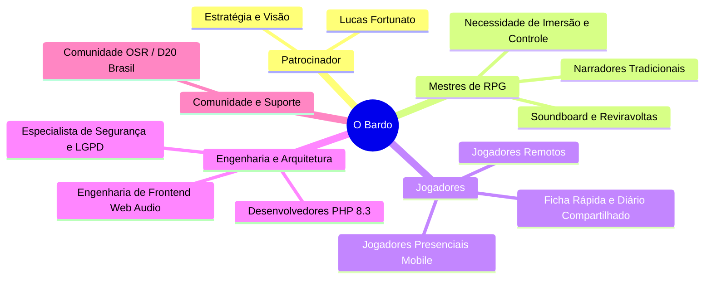

# O BARDO - PLATAFORMA WEB IMERSIVA PARA RPG DE MESA TRADICIONAL
## Termo de Abertura do Projeto (Project Charter)

---

### Informações do Documento
- **Projeto:** O Bardo (obardo.com.br)
- **Repositório Oficial:** [https://github.com/fortunatolf-tech/obardo](https://github.com/fortunatolf-tech/obardo)
- **Versão do Documento:** 1.0.0
- **Data:** 30 de Outubro de 2026
- **Status:** Aprovado para Iniciação e Planejamento
- **Patrocinador Executivo (Sponsor):** Lucas Fortunato (fortunatolf-tech)
- **Líder Técnico / Arquiteto de Software:** Equipe de Engenharia O Bardo

---

## 1. Justificativa do Projeto

O mercado de RPG de mesa (Tabletop Role-Playing Games - TTRPG) vive um momento histórico de expansão global e nacional, impulsionado por fenômenos culturais, transmissões ao vivo (live plays) e o renascimento do movimento Old-School Renaissance (OSR). No entanto, o ecossistema tecnológico atual sofre de uma grave distorção de foco:

1. **Hipertrofia e "Videogamização" das Ferramentas Virtuais (VTTs):** Plataformas hegemônicas (como Foundry VTT e Roll20) tornaram-se simuladores táteis pesados, exigindo computadores com GPUs dedicadas, gigabytes de assets, horas intermináveis de preparação de mapas quadriculados 2D/3D com iluminação dinâmica milimétrica, e automação excessiva de regras que aprisiona a imaginação.
2. **Abandono do "RPG Raiz" (Teatro da Mente):** Os jogadores tradicionais que se reúnem presencialmente em torno de uma mesa física (ou em chamadas de voz simples) buscam o *teatro da mente*, a narrativa compartilhada, a rolagem física ou ágil de dados e o controle desobstruído da história. Para esse público, os VTTs convencionais mais atrapalham do que ajudam.
3. **Fragmentação Acústica e Desafio da Imersão:** A ambientação sonora (trilhas musicais orquestradas e efeitos pontuais como trovões, passos na masmorra e portas rangendo) é comprovadamente o catalisador nº 1 de imersão. Atualmente, os Mestres enfrentam um calvário técnico usando bots de Discord instáveis, extensões de terceiros ou tocadores locais que não sincronizam com os dispositivos dos jogadores.

**O Bardo** nasce para preencher exatamente essa lacuna: um aplicativo web moderno, leve e refinado, construído em **PHP 8.3**, desenhado especificamente para o RPG raiz. Ele unifica em uma interface elegante:
- Fichas de personagem robustas e flexíveis;
- Registro e desenvolvimento colaborativo da crônica em tempo real;
- **Motor central de som e ambientação sincronizado em tempo real** entre o Mestre e os participantes.

---

## 2. Objetivos Estratégicos e Metas Mensuráveis (OKRs)

### 2.1. Objetivos do Projeto
- **Objetivo 1:** Desenvolver uma plataforma web completa em PHP 8.3 de alta performance, sem dependência de softwares pesados do lado do cliente.
- **Objetivo 2:** Proporcionar ao Mestre controle total e intuitivo sobre a narrativa, reviravoltas da trama e o ecossistema sonoro da sessão.
- **Objetivo 3:** Assegurar que 100% dos membros de uma sessão escutem rigorosamente a mesma música e efeitos na fração exata de segundo, em qualquer navegador web moderno (desktop e mobile).
- **Objetivo 4:** Estabelecer conformidade irrevogável com a legislação brasileira de proteção de dados (LGPD - Lei nº 13.709/2018) e normas internacionais de segurança cibernética (OWASP ASVS).

### 2.2. OKRs (Objectives and Key Results)

| ID | Objetivo | Resultado-Chave (KR) | Meta |
| :--- | :--- | :--- | :--- |
| **KR-01** | Desempenho e Leveza | Tempo de carregamento da aplicação (First Contentful Paint) em 4G | $\le 1.2\text{ s}$ |
| **KR-02** | Sincronia de Áudio | Diferença máxima de latência de áudio entre participantes (drift) | $\le 180\text{ ms}$ |
| **KR-03** | Fichas de Personagem | Tempo médio para criar uma ficha completa OSR/D20 | $\le 3\text{ minutos}$ |
| **KR-04** | Confiabilidade de Sessão | Disponibilidade da aplicação durante horários de pico (noites/fins de semana) | $\ge 99.9\%$ |
| **KR-05** | Satisfação do Mestre | Índice de facilidade de acionamento de reviravoltas e SFX (SUS Score) | $\ge 85/100$ |

---

## 3. Escopo do Projeto

### 3.1. Itens Inclusos no Escopo (In-Scope)
1. **Módulo de Fichas de Personagem:**
   - Criação, edição, exportação e importação de fichas;
   - Suporte a sistemas tradicionais (OSR, B/X, D&D 5e/3.5, Tormenta20 e Modelo Livre Personalizado);
   - Cálculo automático de bônus, modificadores, pontos de vida, mana, slots de magia e capacidade de carga (encumbrance);
   - Rolador de dados integrado com notação avançada (ex: `1d20+5`, `4d6kh3`, explosão, vantagem/desvantagem) e registro auditável contra fraudes;
   - Sincronização imediata de status com a visão do Mestre.
2. **Módulo de Crônicas e História Colaborativa:**
   - Painel compartilhado de crônicas da campanha (diário da guilda, linha do tempo dos acontecimentos, registro de sessões);
   - Mural de handouts digitais (cartas envelhecidas, mapas conceituais, enigmas em pergaminho) liberados pelo Mestre;
   - **Mecanismo de Reviravoltas da Trama (Plot Twists):** Ferramenta exclusiva do Mestre para disparar eventos narrativos repentinos com apresentação visual e sonora dramática na tela de todos os jogadores simultaneamente;
   - Bloco de anotações secretas exclusivo para o Mestre e anotações individuais para cada jogador.
3. **Módulo de Áudio e Ambientação Sonora Coesa:**
   - Soundboard do Mestre com disparo instantâneo de efeitos sonoros (SFX);
   - Reprodutor de trilhas de fundo multicamada (música orquestrada + camadas de clima como chuva, taverna, vento de cripta);
   - Algoritmo de sincronização de playback de áudio cliente-servidor (GM Master $\rightarrow$ Players Listeners);
   - Controle individual de volume mestre para cada jogador (respeitando acessibilidade e conforto auditivo);
   - Biblioteca integrada de faixas sonoras gratuitas/royalty-free e suporte para upload seguro de áudios pelo Mestre.
4. **Infraestrutura e Segurança:**
   - Backend PHP 8.3 moderno com arquitetura limpa (PSR-12, tipagem estrita);
   - Banco de dados relacional MariaDB otimizado;
   - Motor de eventos em tempo real (WebSockets / Server-Sent Events);
   - Conformidade estrita com a LGPD e segurança OWASP Top 10.

### 3.2. Itens Fora do Escopo (Out-of-Scope)
- Renderização de mapas de batalha táticos em 3D ou iluminação dinâmica linha-de-visão (Line of Sight - LoS);
- Sistema de videoconferência ou streaming de webcam próprio (usuários utilizam Discord, Meet ou jogam presencialmente na mesma sala);
- Loja proprietária de venda de PDFs de editoras terceiras (o foco inicial é a ferramenta e a experiência de jogo).

---

## 4. Premissas e Restrições

### 4.1. Premissas
- Os usuários (Mestre e Jogadores) dispõem de conexão à internet estável de banda larga ou 4G/5G;
- Os dispositivos dos usuários possuem navegadores web atualizados que suportem a Web Audio API (Google Chrome $\ge 110$, Mozilla Firefox $\ge 110$, Safari $\ge 16$, Edge $\ge 110$);
- O Mestre possui direito de uso ou arquivos sob domínio público / creative commons para as mídias carregadas em sua biblioteca privada.

### 4.2. Restrições Técnicas e Regulatórias
- **Linguagem Backend Obrigatória:** PHP 8.3 com estrita observância aos novos recursos da linguagem (`typed class constants`, `readonly`, `json_validate`, closures aprimoradas);
- **Infraestrutura:** Servidor Linux Nginx 1.27 + MariaDB 10.11 em ambiente de produção `/www/wwwroot/obardo.com.br`;
- **Regulatório:** Cumprimento irrestrito da LGPD (Lei nº 13.709/2018) e Marco Civil da Internet (Lei nº 12.965/2014);
- **Repositório do Projeto:** Manutenção centralizada e controle de versão integral no repositório `https://github.com/fortunatolf-tech/obardo`.

---

## 5. Partes Interessadas (Stakeholders)

---

## 6. Cronograma Preliminar de Marcos (Milestones)

| Marco | Descrição | Prazo Estimado |
| :--- | :--- | :--- |
| **M1** | Elaboração da Documentação Oficial Completa e Protótipos de Alta Fidelidade | Semana 1 |
| **M2** | Configuração do Repositório, CI/CD, Estrutura Base PHP 8.3 e Modelagem de Dados | Semana 2 |
| **M3** | Implementação do Módulo de Autenticação, RBAC e Gestão de Campanhas | Semana 3 |
| **M4** | Desenvolvimento do Módulo de Fichas de Personagem e Rolador de Dados | Semana 4 |
| **M5** | Implementação do Motor de Áudio Sincronizado e Soundboard em Tempo Real | Semana 5 |
| **M6** | Desenvolvimento das Crônicas Colaborativas e Mecanismo de Reviravoltas | Semana 6 |
| **M7** | Testes de Carga, Auditoria de Segurança LGPD/OWASP e Homologação | Semana 7 |
| **M8** | Publicação da Versão 1.0.0 Oficial no Domínio obardo.com.br | Semana 8 |

---

## 7. Critérios de Sucesso e Encerramento do Projeto

O projeto será considerado entregue com êxito mediante:
1. Aprovação formal de todos os 11 artefatos de engenharia de software e cibersegurança/LGPD;
2. Disponibilização e homologação dos protótipos de alta fidelidade;
3. Execução completa dos testes automatizados com cobertura superior a 80% no core da aplicação;
4. Validação em sessão real de RPG teste com 1 Mestre e 5 Jogadores simultâneos, sem falhas de sincronia de som ou perda de dados de ficha;
5. Sincronização de todos os artefatos e código no repositório oficial do GitHub.

---

**Aprovado por:**  
*Lucas Fortunato — Sponsor & Product Owner*  
*Equipe de Engenharia de Software — O Bardo*
