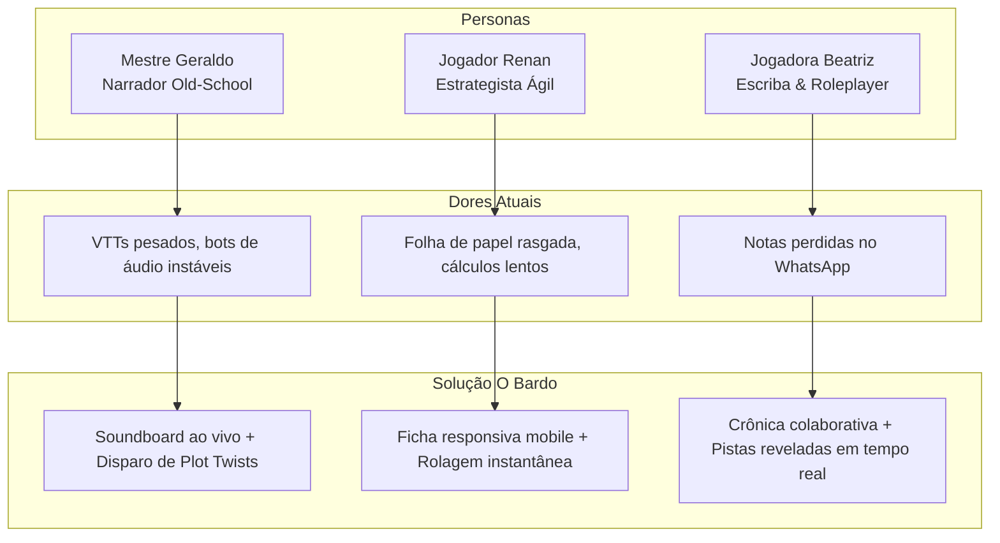

# O BARDO - PLATAFORMA WEB IMERSIVA PARA RPG DE MESA TRADICIONAL
## Documento de Visão e Escopo do Produto

---

### Controle de Versão
- **Versão:** 1.0.0
- **Status:** Oficial
- **Data de Publicação:** 30 de Outubro de 2026
- **Autor:** Engenharia de Produto & Arquitetura de Software - O Bardo
- **Repositório:** [https://github.com/fortunatolf-tech/obardo](https://github.com/fortunatolf-tech/obardo)

---

## 1. Posicionamento do Produto

### 1.1. Declaração de Posição do Produto (Product Positioning Statement)
- **Para** Mestres e jogadores de RPG de mesa tradicional (raiz), tanto presenciais quanto remotos;
- **Que** buscam imersão profunda, narrativa envolvente, agilidade na gestão de fichas e ambientação sonora de alta qualidade, sem as distrações e o peso de simuladores táteis 3D;
- **O Bardo** é uma plataforma web moderna em PHP 8.3;
- **Que** centraliza fichas de personagem dinâmicas, registro colaborativo da crônica da campanha e um motor de som sincronizado em tempo real nos celulares e computadores de todo o grupo;
- **Diferente de** VTTs pesados e complexos (Foundry VTT, Roll20) ou gerenciadores frios de regras (D&D Beyond);
- **Nosso produto** coloca a imaginação humana e a atmosfera acústica no centro da sessão, oferecendo uma experiência ultrarrápida, poética e tecnicamente impecável.

---

## 2. Declaração do Problema e Oportunidade

### 2.1. O Problema
Nos últimos 5 anos, o mercado de Virtual Tabletop (VTT) sofreu o que a comunidade de jogadores chama de "síndrome do videogame":
1. **Perda da Essência:** As mesas deixaram de ser sobre conversa, drama e descrição oral para se tornarem sessões de movimentar miniaturas virtuais em grades milimétricas, calcular campos de visão e debugar scripts de iluminação que travam o navegador de quem não possui um PC gamer.
2. **Caos Sonoro:** Mestres que desejam criar ambientação precisam recorrer a gambiarras complexas (bots de Discord com comandos de texto arcaicos, plug-ins que caem a cada atualização da API do Discord ou interfaces de streaming de áudio com atraso de vários segundos entre um jogador e outro).
3. **Fragmentação de Ferramentas:** Uma sessão típica de RPG raiz hoje usa de 4 a 6 ferramentas simultâneas: uma planilha de Excel ou PDF para as fichas, um Google Docs para as anotações, um bot de dados no Discord, um canal de áudio separado e o WhatsApp para troca de fotos de mapas e pistas.

### 2.2. A Oportunidade
Existe uma comunidade massiva e leal — impulsionada pelo movimento OSR (Old School Renaissance), fãs de sistemas clássicos como D&D B/X, Advanced D&D, Tormenta20, Chamado de Cthulhu e sistemas narrativos — que anseia por uma **ferramenta companheira de mesa (Tabletop Companion)**:
- Um sistema que roda no navegador de um smartphone barato na mesa da sala com café e dados físicos;
- Um sistema que, ao mesmo tempo, sincroniza um trovão ensurdecedor ou uma melodia melancólica de alaúde nos fones de todos os amigos conectados;
- Um sistema que permite ao Mestre dar um clique e estampar na tela de todos: *"A tocha se apaga. Passos ecoam atrás de vocês."* com iluminação de tela pulsante e trilha de suspense.

---

## 3. Personas e Cenários de Uso

### 3.1. Persona 1: O Mestre Narrativo (Geraldo, 42 anos)
- **Perfil:** Mestre veterano com mais de 20 anos de experiência. Conduz campanhas semanais.
- **Necessidades:** Controlar o ritmo da narrativa sem ficar enterrado em telas de configuração técnica. Quer soltar um efeito sonoro na hora exata em que descreve uma armadilha, sem que o jogador receba o som 5 segundos depois.
- **Como O Bardo o atende:** O painel do Mestre oferece atalhos para trilhas de ambiente (Taverna, Floresta Misteriosa, Combate Brutal), soundboard de um clique (uivo de lobo, golpe de espada) e o disparador de *Plot Twists*.

### 3.2. Persona 2: O Jogador Móvel da Mesa Física (Renan, 28 anos)
- **Perfil:** Joga quinzenalmente na casa de amigos. Leva apenas o smartphone.
- **Necessidades:** Consultar facilmente seus pontos de vida, bônus de ataque e itens na mochila. Odeia apagar o papel até furar a folha quando leva dano.
- **Como O Bardo o atende:** Acessa a ficha web responsiva, atualiza PVs com um toque, clica para rolar `1d20+7` e o Mestre já visualiza a rolagem na tela central.

### 3.3. Persona 3: A Escriba da Guilda (Beatriz, 31 anos)
- **Perfil:** Focada em lore, história e interpretação de personagens (roleplay).
- **Necessidades:** Manter o histórico da campanha organizado, saber quais pistas foram descobertas e ler o diário compartilhado da equipe.
- **Como O Bardo a atende:** Módulo colaborativo de crônicas onde o grupo documenta os feitos lendários, com mural de imagens e cartas deixadas pelo Mestre.

---

## 4. Limites de Escopo e Mapeamento de Funcionalidades

### 4.1. Funcionalidades Essenciais (Release 1.0)
| Módulo | Funcionalidades Incluídas |
| :--- | :--- |
| **Módulo 1: Fichas de Personagem** | - Construtor de Fichas (OSR, D&D 5e/3.5, Tormenta20, Custom). - Cálculo automático de Atributos, Modificadores, PV, CA, Carga. - Grimório de Magias com slots e descrições. - Rolador de dados matemático com semente criptográfica e audit log. - Atualização bidirecional em tempo real (Jogador $\leftrightarrow$ Mestre). |
| **Módulo 2: Crônicas & História** | - Registro compartilhado da história e sessões (timeline cronológica). - Mural de Handouts visuais (cartas, enigmas, brasões, pistas). - **Disparador de Reviravoltas do Mestre (Live Plot Twists):** Apresentação dramática sincronizada em tela cheia com áudio temático associado. - Notas privadas do Mestre e diário individual dos jogadores. |
| **Módulo 3: Som & Ambientação** | - Soundboard com disparo de efeitos instantâneos (SFX). - Reprodutor de trilhas de fundo multicamada (Música + Ambientes simultâneos). - Sincronizador de áudio em tempo real com compensação de latência (NTP-like). - Mixer individual de volume por participante. - Gestão de acervo sonoro e upload de faixas de áudio seguras. |
| **Módulo 4: Gestão da Campanha** | - Painel de criação e configuração de campanhas. - Convites rápidos via link criptográfico ou código curto. - Controle de presença e membros com permissões hierárquicas (Mestre vs Jogador). |

### 4.2. Escopo Futuro (Post-1.0 Roadmap)
- Módulo de geração de NPCs e ganchos de aventura assistidos por IA generativa local ou API segura;
- Exportador de fichas diagramadas em PDF de alta qualidade para impressão em papel pergaminho;
- Modo offline (PWA com cache local de fichas e sincronização posterior);
- Aplicativo nativo empacotado para iOS e Android caso haja demanda da comunidade.

---

## 5. Critérios de Sucesso e Métricas de Engajamento

1. **Adoção e Retenção:**
   - 70% das campanhas criadas atingirem mais de 3 sessões consecutivas de uso contínuo;
   - Tempo médio de permanência ativa na tela da Taverna durante sessões de jogo superior a 180 minutos.
2. **Eficiência Operacional:**
   - Zero incidentes de perda de ficha ou corrupção de dados de campanha;
   - Latência do evento de reviravolta (Plot Twist) perceptível em menos de 250ms após o clique do Mestre.
3. **Imersão Comprovada:**
   - 90% dos usuários em pesquisa de satisfação declarando que a sincronização sonora aumentou significativamente o engajamento da mesa em comparação aos métodos anteriores.

---

*Documento revisado e homologado para a arquitetura de engenharia do projeto O Bardo.*
