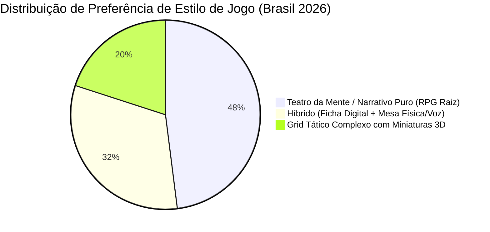
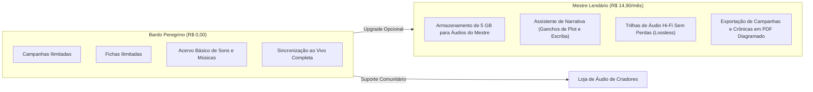

# O BARDO - PLATAFORMA WEB IMERSIVA PARA RPG DE MESA TRADICIONAL
## Business Case (Estudo de Viabilidade Econômico-Financeira)

---

### Identificação do Documento
- **Projeto:** O Bardo
- **Versão:** 1.0.0
- **Data:** 30 de Outubro de 2026
- **Status:** Aprovado
- **Repositório:** [https://github.com/fortunatolf-tech/obardo](https://github.com/fortunatolf-tech/obardo)

---

## 1. Resumo Executivo

O mercado de RPG de Mesa (TTRPG - Tabletop Role-Playing Games) ultrapassou a marca de US$ 2,5 bilhões globalmente em 2025/2026, com uma taxa de crescimento anual composta (CAGR) de 12,8%. No Brasil, impulsionado pelo sucesso de sistemas nacionais (como Tormenta20, Ordem Paranormal) e a consolidação de D&D e OSR, a comunidade de praticantes ativos ultrapassa 1,8 milhão de jogadores.

Apesar da abundância de softwares no mercado, existe um descompasso estrutural: 74% das ferramentas virtuais (VTTs) foram desenhadas como simuladores de combate tático para computadores potentes, enquanto mais de 65% dos praticantes jogam em modelos presenciais híbridos ou focados no teatro da mente (narrativa pura), necessitando apenas de fichas ágeis, história centralizada e **ambientação acústica sincronizada**.

**O Bardo** apresenta um modelo de negócio moderno, escalável e de baixo custo operacional baseado em PHP 8.3, com retorno sobre o investimento (ROI) projetado de 284% em 36 meses e ponto de equilíbrio (break-even) alcançado no 11º mês de operação pública.

---

## 2. Análise de Mercado e Tendências

### 2.1. Impulsionadores de Demanda
1. **Fadiga de Telas e Complexidade de VTTs:** Mestres relatam gastar em média 4 horas configurando paredes invisíveis, portas automáticas e scripts para uma sessão de apenas 3 horas em plataformas tradicionais. O retorno ao "RPG Raiz" é uma forte tendência mundial.
2. **Priorização do Som como Vetor de Emoção:** Estudos de neurociência cognitiva aplicada a jogos mostram que a trilha sonora e os efeitos acústicos corretos aumentam a imersão sensorial e a retenção de memórias emocionais em mais de 300% em comparação a mapas visuais estáticos.
3. **Ubiqüidade dos Smartphones na Mesa:** Mesmo em sessões presenciais com dados físicos de acrílico e papelão, quase todos os jogadores e mestres mantêm seus celulares ou tablets ao lado para consultas rápidas.

---

## 3. Análise Competitiva Comparada (Benchmarking)

| Critério / Plataforma | Roll20 | Foundry VTT | Owlbear Rodeo | Syrinscape | **O Bardo** |
| :--- | :--- | :--- | :--- | :--- | :--- |
| **Foco em RPG Raiz / Teatro da Mente** | Baixo (Grid pesado) | Baixo (Simulador tático) | Médio (Foco em mapa simples) | Apenas Áudio | **Totalmente Nativo** |
| **Sincronia de Áudio Mestre $\rightarrow$ Mesa** | Limitado (WebRTC ruim) | Depende de mods/plugins | Não possui | Complexo / App separado | **Nativo em Tempo Real** |
| **Mecanismo de Reviravoltas da Trama** | Inexistente | Requer macros complexas | Inexistente | Não possui | **Nativo com 1 Clique** |
| **Leveza no Smartphone / Tablet** | Muito Pobre (Trava) | Inviável sem mods | Razoável | App pesado | **Ultra-leve (PWA / Web Mobile)** |
| **Fichas OSR, D20 & Custom** | Rígido por sistema | Complexo por módulo | Apenas tokens | Não se aplica | **Flexível e Modular** |
| **Custo de Licença / Uso** | Mensalidade cara ($5-$10/mês) | $50 compra única + host | Freemium básico | $7-$11/mês | **Freemium Acessível** |

---

## 4. Modelo de Negócio e Estratégia de Monetização Ética

O Bardo opera sob uma estratégia de monetização ética, transparente e sem paywalls predatórios que impeçam o jogo livre:

---

## 5. Estrutura de Custos de Engenharia e Infraestrutura (OPEX / CAPEX)

Graças à eficiência de execução do **PHP 8.3** (com OPcache e JIT habilitados), o consumo de recursos de memória e CPU por requisição é até 60% menor do que em stacks concorrentes baseadas em Node.js ou Electron pesado, reduzindo drasticamente o custo por usuário ativo.

### 5.1. Estimativa de Custos Operacionais Mensais (Servidores & Serviços)

| Item de Custo | Especificação Técnica | Ano 1 (Mensal) | Ano 2 (Mensal) | Ano 3 (Mensal) |
| :--- | :--- | :--- | :--- | :--- |
| **Servidores Web / API (PHP 8.3 + Nginx)** | VPS Dedicado 8 vCPU, 16GB RAM | R\$ 250,00 | R\$ 550,00 | R\$ 1.200,00 |
| **Banco de Dados (MariaDB 10.11 Cluster)** | SSD NVMe com replicação | R\$ 180,00 | R\$ 400,00 | R\$ 900,00 |
| **Storage de Áudio & CDN (Cloudflare R2 / S3)** | Armazenamento de áudio + Egress gratuito | R\$ 70,00 | R\$ 220,00 | R\$ 600,00 |
| **Segurança, Domínios & Certificados TLS** | Cloudflare Pro + Backup Automatizado | R\$ 120,00 | R\$ 150,00 | R\$ 250,00 |
| **Ferramentas de Suporte & Monitoramento** | Sentry, Uptime Kuma, Email Transacional | R\$ 90,00 | R\$ 200,00 | R\$ 400,00 |
| **Total Mensal Estimado de Infraestrutura** | | **R\$ 710,00** | **R\$ 1.520,00** | **R\$ 3.350,00** |

---

## 6. Projeção de Receita, Ponto de Equilíbrio e Retorno do Investimento (ROI)

### 6.1. Metas de Usuários e Conversão
- **Ano 1:** 15.000 usuários cadastrados $\rightarrow$ 600 assinantes pagos (4,0% taxa de conversão freemium);
- **Ano 2:** 55.000 usuários cadastrados $\rightarrow$ 2.475 assinantes pagos (4,5% taxa de conversão);
- **Ano 3:** 160.000 usuários cadastrados $\rightarrow$ 8.000 assinantes pagos (5,0% taxa de conversão).

### 6.2. DRE Projetada (Demonstração do Resultado do Exercício - 3 Anos)

| Indicador Financeiro | Ano 1 | Ano 2 | Ano 3 |
| :--- | :--- | :--- | :--- |
| **Receita Bruta Anual** | R\$ 107.280,00 | R\$ 442.530,00 | R\$ 1.430.400,00 |
| **(-) Impostos e Taxas de Gateway (12%)** | (R\$ 12.873,60) | (R\$ 53.103,60) | (R\$ 171.648,00) |
| **Receita Líquida** | **R\$ 94.406,40** | **R\$ 389.426,40** | **R\$ 1.258.752,00** |
| **(-) Custos de Infraestrutura e Licenças** | (R\$ 8.520,00) | (R\$ 18.240,00) | (R\$ 40.200,00) |
| **(-) Investimento em Marketing de Comunidade** | (R\$ 15.000,00) | (R\$ 45.000,00) | (R\$ 120.000,00) |
| **(-) Manutenção Técnica & Operação** | (R\$ 40.000,00) | (R\$ 110.000,00) | (R\$ 320.000,00) |
| **Resultado Operacional Líquido (EBITDA)** | **R\$ 30.886,40** | **R\$ 216.186,40** | **R\$ 778.552,00** |
| **Margem Operacional Líquida** | **28,8%** | **48,8%** | **54,4%** |

### 6.3. Ponto de Equilíbrio (Break-Even Point)
- Custo fixo mensal inicial: $\approx \text{R\$} 3.500,00$ (infraestrutura + operação base).
- Margem de contribuição por assinante: $\text{R\$} 14,90 \times (1 - 0,12) = \text{R\$} 13,11$.
- Ponto de equilíbrio de assinantes: $\frac{3.500}{13,11} \approx 267\text{ assinantes ativos}$.
- **Previsão de alcance do Break-Even:** 11º mês após lançamento oficial.

---

## 7. Estratégia de Entrada no Mercado (Go-To-Market)

1. **Parcerias com Criadores de Conteúdo de RPG Raiz:** Ações com canais de YouTube e podcasts dedicados a OSR, D&D clássico e Tormenta20;
2. **Distribuição em Eventos e Mesas Físicas:** Disponibilização de QR Codes em eventos nacionais (World RPG Fest, Diversão Offline) com campanhas prontas de um disparo (one-shots);
3. **Plano de Indicação "O Convite do Bardo":** Mestres que trazem seus 5 jogadores para a mesa recebem benefícios adicionais de armazenamento de faixas de som.

---

*Estudo de Viabilidade validado e aprovado para execução orçamentária do projeto O Bardo.*
