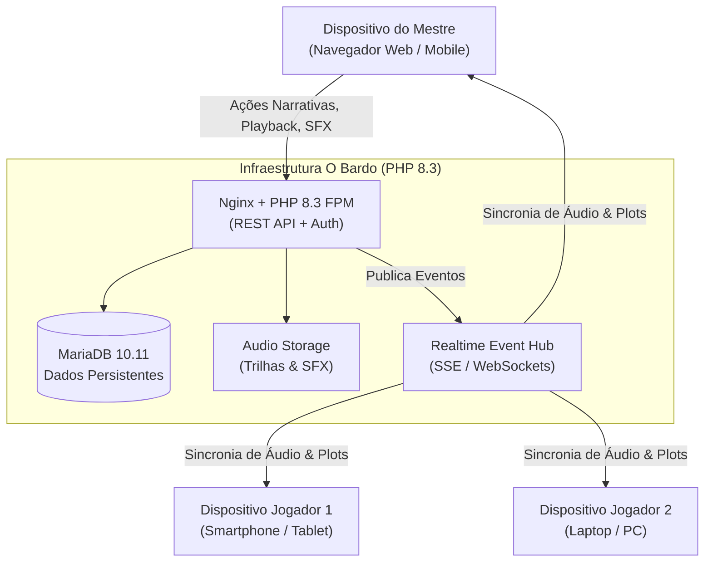

# O BARDO - PLATAFORMA WEB IMERSIVA PARA RPG DE MESA TRADICIONAL
## Especificação de Requisitos de Software (SRS - IEEE Std 830 / ISO/IEC/IEEE 29148)

---

### Controle do Documento
- **Projeto:** O Bardo
- **Identificador:** SRS-OBAR-2026-V1
- **Versão:** 1.0.0
- **Data de Vigência:** 30 de Outubro de 2026
- **Status:** Aprovado e Linha de Base (Baseline)
- **Repositório Oficial:** [https://github.com/fortunatolf-tech/obardo](https://github.com/fortunatolf-tech/obardo)

---

## 1. Introdução

### 1.1. Propósito
Este documento define formalmente os requisitos funcionais, requisitos não-funcionais, restrições arquiteturais e regras de negócio para o desenvolvimento do sistema **O Bardo**, uma aplicação web desenvolvida em **PHP 8.3**, desenhada especificamente para atender grupos de RPG de mesa tradicional (raiz).

### 1.2. Escopo do Produto
O Bardo provê aos participantes de campanhas de RPG um ambiente integrado, seguro e em tempo real para:
1. Gerenciamento e cálculo automático de fichas de personagens de múltiplos sistemas clássicos e customizados;
2. Documentação colaborativa e em tempo real da história da campanha (diário da guilda, linha do tempo, murais de pistas e handouts);
3. Orquestração e sincronização simultânea de áudio e efeitos sonoros ambientais controlados exclusivamente pelo Mestre da campanha para todos os dispositivos conectados na sessão;
4. Execução de reviravoltas dramáticas na trama (*Live Plot Twists*) com impacto audiovisual sincronizado.

### 1.3. Definições, Acrônimos e Abreviações
- **TTRPG:** *Tabletop Role-Playing Game* (RPG de mesa tradicional);
- **OSR:** *Old-School Renaissance* (estilo de jogo clássico com ênfase na criatividade do jogador e perigo iminente);
- **Mestre (GM / DM):** *Game Master / Dungeon Master*, árbitro e narrador da campanha;
- **Jogador (Player):** Participante que controla um ou mais personagens na história;
- **VTT:** *Virtual Tabletop*;
- **SSE:** *Server-Sent Events* (mecanismo de envio de eventos unidirecionais em tempo real do servidor para os clientes via HTTP padrão);
- **NTP-Lite:** Protocolo simplificado de sincronização de relógio lógico para alinhamento de timestamps de reprodução de áudio;
- **PV / HP:** Pontos de Vida (*Hit Points*);
- **CA / AC:** Classe de Armadura (*Armor Class*);
- **SFX:** *Sound Effects* (efeitos sonoros breves, ex.: trovão, porta rangendo, desembainhar de espada).

---

## 2. Descrição Geral

### 2.1. Perspectiva do Produto
O sistema opera como uma aplicação web nativa no servidor web Nginx com backend PHP 8.3 e banco de dados relacional MariaDB 10.11, comunicando-se com navegadores web modernos por meio de APIs RESTful estruturadas em JSON e um canal de eventos em tempo real de altíssima eficiência.

### 2.2. Perfis de Acesso (User Roles)
1. **Administrador do Sistema:** Gestão de infraestrutura, auditoria de segurança e moderação geral.
2. **Mestre da Campanha (GM):** Dono da campanha com permissões administrativas exclusivas para:
   - Controlar o fluxo do áudio e soundboard sincronizado;
   - Acionar reviravoltas da trama (*Plot Twists*);
   - Inserir pistas secretas, gerenciar membros e editar qualquer ficha da mesa;
   - Iniciar e encerrar sessões oficiais de jogo.
3. **Jogador Participante:**
   - Criação e edição da sua própria ficha de personagem;
   - Visualização das fichas públicas dos companheiros de equipe;
   - Contribuição no diário da guilda e acesso aos handouts revelados pelo Mestre;
   - Rolagem de dados e recepção automática das trilhas de som e eventos do Mestre.

---

## 3. Requisitos Funcionais (RF)

### 3.1. Módulo 1: Autenticação, Usuários e Gestão de Campanhas

- **RF01 - Cadastro de Usuários:** O sistema deve permitir o cadastro de novos usuários com Nome, E-mail válido e Senha forte (mínimo 8 caracteres, contendo maiúsculas, minúsculas e números).
- **RF02 - Autenticação Segura:** O sistema deve autenticar usuários utilizando Argon2id para derivação e verificação de hash de senha, emitindo tokens de sessão assinados com proteção contra adulteração.
- **RF03 - Criação de Campanhas:** O usuário autenticado pode criar uma nova campanha informando título, descrição, sistema de RPG base (OSR, D&D 5e/3.5, Tormenta20, Genérico) e imagem de capa. Ao criar, o usuário torna-se automaticamente o **Mestre** daquela campanha.
- **RF04 - Convite de Participantes:** O Mestre deve poder gerar um link de convite criptográfico temporário ou código alfanumérico curto (ex: `BARDO-7K2X`) para que jogadores ingressem na campanha.
- **RF05 - Gestão de Membros:** O Mestre pode visualizar os participantes ativos, promover um membro a Co-Mestre, revogar acessos ou expulsar participantes com atualização imediata de permissões.

---

### 3.2. Módulo 2: Fichas de Personagens

- **RF06 - Modelos de Fichas (Templates):** O sistema deve disponibilizar estruturas pré-configuradas para sistemas clássicos (OSR / D&D B/X, D&D 5e, Tormenta20) e um construtor de modelo customizável livre.
- **RF07 - Atributos e Modificadores:** O sistema deve calcular automaticamente modificadores a partir dos atributos primários (ex: Força, Destreza, Constituição, Inteligência, Sabedoria, Carisma) com base na tabela do sistema selecionado.
- **RF08 - Pontos de Vida (PV) e Mana:** O jogador e o Mestre devem poder alterar os Pontos de Vida atuais, temporários e máximos, com feedback visual de estado de perigo (saudável, ferido, inconsciente, morto).
- **RF09 - Inventário e Cálculo de Carga (Encumbrance):** O sistema deve fornecer controle de itens, armas, armaduras e suprimentos com cálculo automatizado do peso/slots totais ocupados e penalidade de movimento caso a carga máxima seja ultrapassada.
- **RF10 - Grimório de Magias:** O sistema deve permitir cadastrar magias com círculo, custo, tempo de conjuração, alcance, descrição e controle de slots gastos/restantes.
- **RF11 - Rolador de Dados Integrado:** O sistema deve possuir um interpretador de notações de dados matemáticos (`NdX+K`, `kh`, `kl`, `!`, `adv`, `dis`), utilizando gerador de números aleatórios criptograficamente seguro (`random_int` / CSPRNG) com log público auditável na sessão.
- **RF12 - Rolagens Secretas do Mestre:** O Mestre deve ter a opção de realizar rolagens secretas cujo resultado é visível unicamente para ele, mas com registro de timestamp para evitar questionamentos.
- **RF13 - Sincronização Imediata da Ficha:** Quaisquer alterações nos PVs, condições de status ou equipamentos de um personagem devem ser refletidas em tempo real para o Mestre da campanha sem necessidade de recarregar a página.

---

### 3.3. Módulo 3: Crônicas, Diário de Bordo e Reviravoltas da Trama

- **RF14 - Diário Compartilhado da Guilda:** Jogadores e Mestre podem redigir anotações sobre os acontecimentos da sessão com suporte a formatação rica (Markdown seguro) e categorização por datas de jogo ou capítulos.
- **RF15 - Mural de Handouts e Pistas:** O Mestre deve poder adicionar pistas visuais, cartas seladas e mapas conceituais. Cada handout pode estar no estado "Oculto" ou "Revelado para o Grupo".
- **RF16 - Disparador de Reviravoltas da Trama (Live Plot Twist):** O Mestre deve possuir uma ferramenta de disparo rápido de reviravoltas da trama. Ao acionar:
  - Uma mensagem de impacto dramático pré-configurada ou digitada na hora é sobreposta na tela de todos os participantes;
  - Um efeito sonoro de clímax e/ou troca de trilha de suspense é disparado automaticamente;
  - A iluminação visual da interface pulsa momentaneamente no tom correspondente ao tipo de reviravolta (Traição, Morte, Descoberta Sombria, Salvação Milagrosa).
- **RF17 - Bloco de Segredos do Mestre:** Área restrita da campanha onde o Mestre mantém anotações, fichas de monstros secretas e ganchos futuros com garantia estrita de que nenhum payload ou dado vaze para os jogadores via API.
- **RF18 - Linha do Tempo da Campanha:** Visualização cronológica dos fatos marcantes da campanha registrados automaticamente a partir dos resumos de sessão.

---

### 3.4. Módulo 4: Som e Ambientação Sonora Sincronizada

- **RF19 - Reprodutor de Trilhas de Fundo Multicamada:** O sistema deve permitir a reprodução paralela e independente de duas camadas sonoras contínuas:
  - *Camada Musical (Score/BGM):* Melodias orquestradas, taverna, combate, viagem;
  - *Camada Ambiental (Ambience Loop):* Sons de chuva contínua, vento uivante, murmúrio de clientes, fogueira estalando.
- **RF20 - Soundboard de Disparo Imediato (SFX):** O painel do Mestre deve oferecer grade de botões para disparo instantâneo de efeitos pontuais (ex: grito, lâmina de espada, trovão, porta se abrindo, armadilha desarmada).
- **RF21 - Sincronização Automática com Clientes (Broadcast Playback):** Quando o Mestre pressionar Play, Pause, mudar de faixa, avançar posição no tempo ou disparar um SFX, o comando deve ser transmitido a todos os navegadores participantes da sessão em menos de 200ms.
- **RF22 - Compensação de Drift de Latência:** O cliente do jogador deve sincronizar sua posição de áudio com base no timestamp do servidor ($t_{\text{target}} = t_{\text{start}} + \Delta t$), efetuando correções suaves de velocidade de reprodução ($\pm 3\%$) se a diferença for entre 100ms e 500ms, ou salto direto se a diferença ultrapassar 500ms.
- **RF23 - Mixer de Volume Local para Jogadores:** Cada participante deve ter controle sobre o volume global de seu próprio dispositivo para garantir conforto e acessibilidade, sem interferir no volume dos demais jogadores.
- **RF24 - Fade-In e Cross-Fade:** As transições entre faixas de combate e exploração disparadas pelo Mestre devem aplicar cross-fade automático suave de 2 a 4 segundos.
- **RF25 - Biblioteca Sonora Integrada:** O sistema deve vir pré-carregado com acervo de faixas musicais e efeitos sonoros sob licenças abertas (Creative Commons Zero / Domínio Público).
- **RF26 - Upload de Áudio Privado pelo Mestre:** Mestres com plano habilitado podem fazer upload de seus próprios arquivos nos formatos MP3 e OGG (Vorbis/Opus), com validação rigorosa de integridade e metadados.

---

## 4. Requisitos Não-Funcionais (RNF)

### 4.1. Desempenho e Eficiência
- **RNF01 - Tempo de Carregamento Inicial:** A página inicial e o painel de sessão devem ter tempo de carregamento de recursos críticos inferior a 1,5 segundos em conexões 4G padrão.
- **RNF02 - Latência de Notificação:** Eventos em tempo real disparados pelo Mestre (rolagens, reviravoltas, comandos de som) devem chegar a 95% dos clientes em menos de 200ms.
- **RNF03 - Consumo de Memória do Navegador:** A interface da aplicação web não deve ultrapassar 80 MB de memória RAM consumida na aba do navegador mesmo após 4 horas de sessão contínua.

### 4.2. Confiabilidade e Disponibilidade
- **RNF04 - Disponibilidade (SLA):** A infraestrutura deve manter disponibilidade mínima de 99,9% durante os horários nobres de sessões de RPG (quintas a domingos, das 18h às 02h).
- **RNF05 - Persistência Segura contra Falhas:** Em caso de perda repentina de conexão do jogador, todos os dados da ficha já preenchidos devem ter sido salvos e persistidos no banco de dados.

### 4.3. Segurança e Privacidade (LGPD & OWASP)
- **RNF06 - Criptografia em Trânsito:** Todo o tráfego HTTP deve ser forçado sobre HTTPS utilizando exclusivamente TLS 1.3 ou 1.2 com ciphers modernos.
- **RNF07 - Proteção contra OWASP Top 10:** O código PHP 8.3 deve utilizar estritamente consultas parametrizadas PDO para eliminar qualquer risco de SQL Injection, sanitização rigorosa de entradas contra XSS e verificação de CSRF em todos os formulários.
- **RNF08 - Conformidade com a LGPD (Lei nº 13.709/2018):** Armazenamento de dados pessoais restrito ao indispensável para a prestação do serviço, com canais de exportação de dados e revogação de consentimento com exclusão definitiva de conta.

### 4.4. Usabilidade e Acessibilidade
- **RNF09 - Responsividade e Design Mobile-First:** A interface deve adaptar-se com perfeição a telas desde 360px (smartphones compactos) até telas de alta resolução 4K (monitores de mestres).
- **RNF10 - Conformidade WCAG 2.1 AA:** Contraste mínimo de 4.5:1 para textos normais e 3:1 para textos grandes, além de suporte a navegação por teclado e leitores de tela.

---

## 5. Regras de Negócio (RN)

- **RN01 - Unicidade do Mestre Primário:** Toda campanha possui exatamente um Mestre Criador que detém o poder de transferir a titularidade ou encerrar a campanha.
- **RN02 - Exclusividade de Controle de Som:** Somente o Mestre da campanha pode iniciar, pausar, alternar faixas e disparar efeitos sonoros no canal sincronizado da sessão.
- **RN03 - Autorização de Edição de Fichas:** O jogador criador da ficha e o Mestre da campanha possuem permissão de escrita sobre a ficha. Os demais jogadores participantes da mesma campanha possuem permissão apenas de leitura sobre os campos públicos da ficha.
- **RN04 - Integridade de Rolagens:** Nenhuma rolagem de dados registrada pode ser apagada ou editada retroativamente no histórico da sessão, garantindo a legitimidade das partidas.
- **RN05 - Autoplay de Áudio nos Navegadores:** Para contornar a política de bloqueio de autoplay dos navegadores web modernos (Web Audio Autoplay Policy), o participante deve obrigatoriamente interagir ao menos uma vez com a página (ex: clicar no botão "Entrar na Taverna / Sintonizar Sons") para liberar o canal de áudio da sessão.
- **RN06 - Isolamento de Segredos do Mestre:** Informações marcadas como secretas pelo Mestre nunca são enviadas nas respostas JSON de jogadores; o filtro é aplicado em nível de camada de aplicação no backend PHP.

---

## 6. Matriz de Rastreabilidade

| Código do Requisito | Módulo | Ator Principal | Caso de Uso Associado |
| :--- | :--- | :--- | :--- |
| **RF01, RF02** | Autenticação | Visitante | UC01 - Registrar e Acessar Conta |
| **RF03, RF04, RF05** | Campanhas | Mestre | UC02 - Criar e Gerenciar Campanha |
| **RF06 a RF13** | Fichas | Jogador / Mestre | UC03 - Montar Ficha e Rolar Dados |
| **RF14, RF15, RF18** | Crônicas | Todos | UC04 - Registrar e Acompanhar História |
| **RF16, RF17** | Reviravoltas | Mestre | UC05 - Disparar Plot Twist ao Vivo |
| **RF19 a RF26** | Som | Mestre / Jogador | UC06 - Orquestrar e Ouvir Sessão Sincronizada |

---

*Especificação homologada para o desenvolvimento do core PHP 8.3 do sistema O Bardo.*
