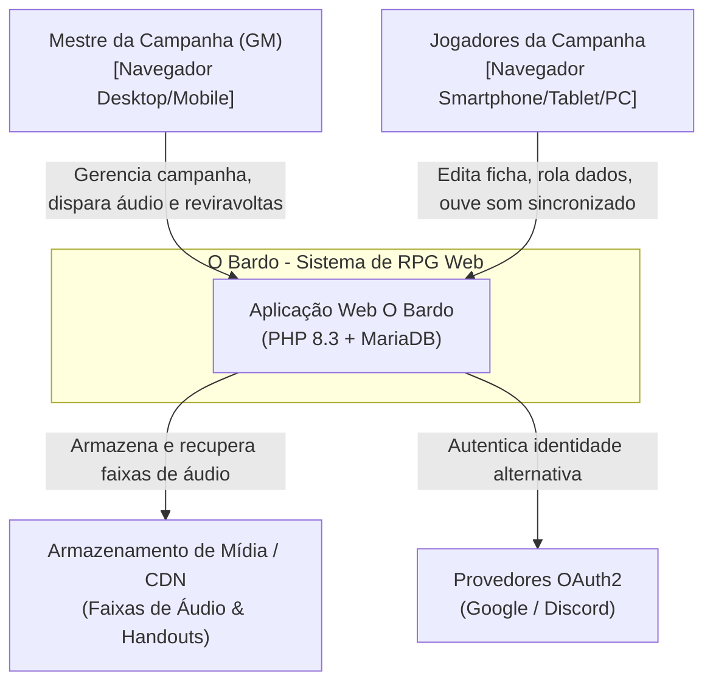
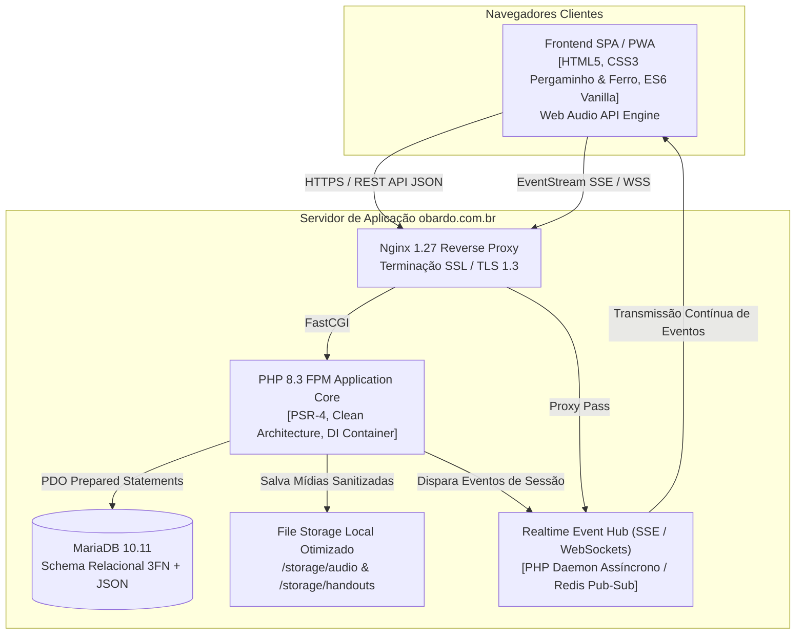
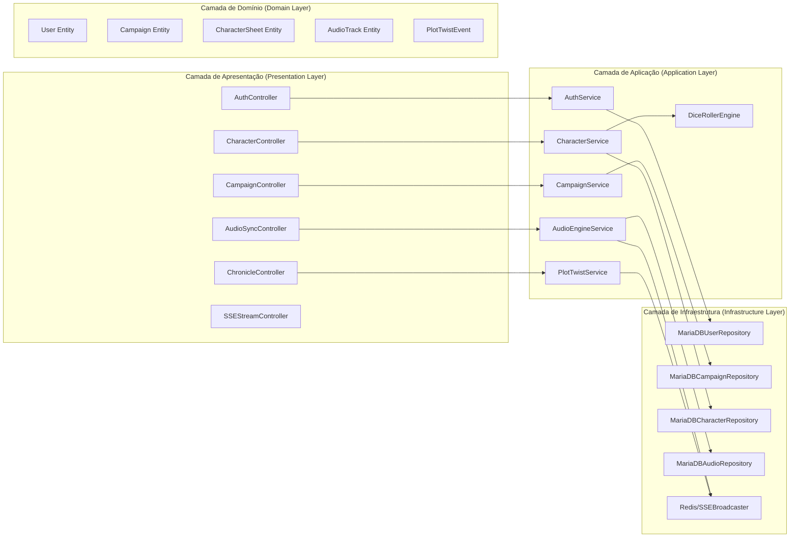
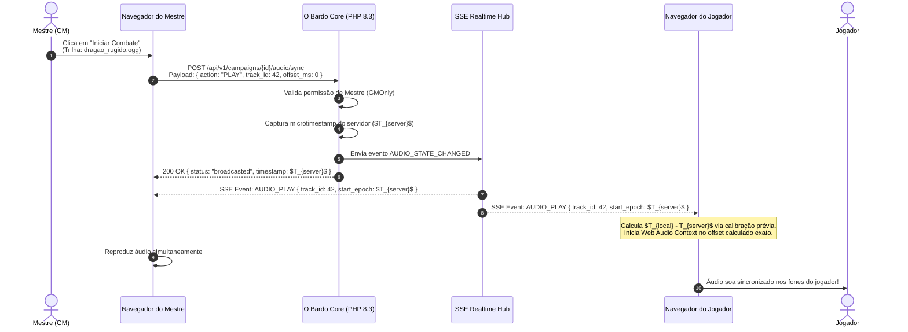
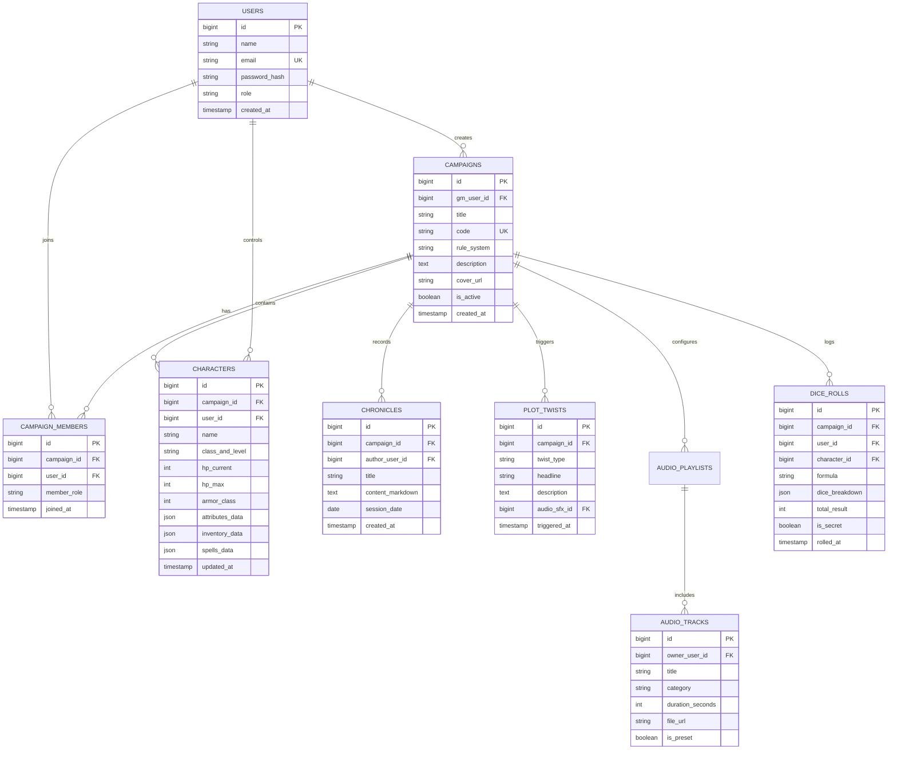

# O BARDO - PLATAFORMA WEB IMERSIVA PARA RPG DE MESA TRADICIONAL
## Descrição de Arquitetura de Software (SAD - IEEE Std 42010 / C4 Model)

---

### Controle do Documento
- **Projeto:** O Bardo (obardo.com.br)
- **Identificador:** SAD-OBAR-2026-V1
- **Versão:** 1.0.0
- **Data:** 30 de Outubro de 2026
- **Status:** Aprovado para Implementação
- **Autor:** Arquiteto de Software Chefe
- **Repositório:** [https://github.com/fortunatolf-tech/obardo](https://github.com/fortunatolf-tech/obardo)

---

## 1. Visão Geral da Arquitetura e Decisões Técnicas (ADRs)

A arquitetura do sistema **O Bardo** foi concebida sob os princípios da Arquitetura Hexagonal (Ports & Adapters) combinada com *Clean Architecture*, priorizando:
1. **Desacoplamento estrito do domínio:** As regras de negócio de RPG (cálculo de fichas, dados, inventário, sincronia) são independentes de frameworks web ou bancos de dados específicos;
2. **Eficiência extrema em PHP 8.3:** Uso intensivo dos recursos modernos de tipagem estrita, classes imutáveis e compilação JIT;
3. **Simplicidade Operacional e Alta Disponibilidade:** Eliminação de arquiteturas excessivamente complexas que demandam múltiplos microsserviços pesados;
4. **Baixa Latência de Áudio:** Utilização da Web Audio API no cliente aliada a um canal ultraleve de Server-Sent Events (SSE) e WebSockets.

### 1.1. Registros de Decisão de Arquitetura (ADRs - Architecture Decision Records)

- **ADR-01: Adoção do PHP 8.3 Moderno**
  - *Contexto:* Necessidade de um backend robusto, de alta performance e baixo consumo de memória em servidores dedicados.
  - *Decisão:* Adotar PHP 8.3 nativo com `strict_types=1`, `readonly classes`, constantes tipadas (`typed class constants`), `json_validate()` para sanitização rápida de payloads e OPcache com JIT (*Tracing*).
  - *Consequência:* Performance equivalente a plataformas compiladas com manutenção limpa e custo de infraestrutura reduzido.
- **ADR-02: Mecanismo de Sincronização em Tempo Real (SSE + Fallback WebSocket)**
  - *Contexto:* Sincronizar o estado de áudio e reviravoltas do Mestre com todos os participantes.
  - *Decisão:* Utilizar Server-Sent Events (SSE) como transporte principal para distribuição de eventos Mestre $\rightarrow$ Jogadores e WebSockets para chat bidirecional em tempo real. SSE opera sobre HTTP padrão, é imune a bloqueios de proxies corporativos e consome frações mínimas de recursos em Nginx.
- **ADR-03: Web Audio API no Frontend**
  - *Contexto:* Execução simultânea de música contínua + ambiência de chuva + disparos pontuais de efeitos sonoros sem travar a interface.
  - *Decisão:* Criar um motor de áudio cliente em JavaScript puro utilizando nós de ganho independentes (`GainNode`), `AudioContext` com compensação de *clock drift* e decodificação assíncrona de buffers.
- **ADR-04: Banco de Dados Relacional MariaDB 10.11 com JSON Columns**
  - *Contexto:* As fichas de personagem de RPG possuem atributos dinâmicos e inventários que variam conforme o sistema (OSR vs D&D 5e vs Tormenta20).
  - *Decisão:* Estrutura relacional sólida para entidades principais (Usuários, Campanhas, Membros, Sessões, Trilhas) combinada com colunas JSON indexadas e validadas para a carga flexível dos personagens.

---

## 2. Visão Arquitetural em C4 Model

### 2.1. Nível 1: Diagrama de Contexto de Sistema (System Context)



---

### 2.2. Nível 2: Diagrama de Contêineres (Containers Diagram)



---

### 2.3. Nível 3: Diagrama de Componentes do Backend (Component Diagram)



---

## 3. Arquitetura em Camadas (Clean / Hexagonal)

O código-fonte segue a estrutura de namespaces em conformidade com o padrão PSR-4 (`OBardo\`):

```
src/
├── Domain/
│   ├── Campaign/
│   │   ├── Model/Campaign.php
│   │   ├── Repository/CampaignRepositoryInterface.php
│   │   └── ValueObject/CampaignCode.php
│   ├── Character/
│   │   ├── Model/CharacterSheet.php
│   │   ├── Model/AttributeSet.php
│   │   ├── Model/InventoryItem.php
│   │   ├── Service/DiceFormulaParser.php
│   │   └── Strategy/RuleSystemStrategyInterface.php (OSR, D20, Tormenta)
│   ├── Audio/
│   │   ├── Model/AudioTrack.php
│   │   ├── Model/AudioSyncState.php
│   │   └── ValueObject/PlaybackCommand.php
│   └── Story/
│       ├── Model/ChronicleEntry.php
│       ├── Model/Handout.php
│       └── Model/PlotTwist.php
├── Application/
│   ├── UseCases/
│   │   ├── Audio/BroadcastAudioCommandUseCase.php
│   │   ├── Campaign/JoinCampaignUseCase.php
│   │   ├── Character/RollDiceUseCase.php
│   │   └── Story/TriggerPlotTwistUseCase.php
│   └── DTO/
│       ├── AudioSyncCommandDTO.php
│       ├── CharacterSheetDTO.php
│       └── RollResultDTO.php
├── Infrastructure/
│   ├── Persistence/
│   │   ├── MariaDB/MariaDBConnection.php
│   │   ├── MariaDB/MariaDBCampaignRepository.php
│   │   └── MariaDB/MariaDBCharacterRepository.php
│   ├── Realtime/
│   │   ├── SSEDeliveryChannel.php
│   │   └── EventPublisherInterface.php
│   └── Security/
│       ├── Argon2idPasswordHasher.php
│       └── TokenManager.php
└── Presentation/
    ├── Http/
    │   ├── Controllers/
    │   ├── Middleware/ (AuthMiddleware, GMOnlyMiddleware, RateLimitMiddleware)
    │   └── Router.php
    └── Views/
```

---

## 4. Mecanismo de Sincronização em Tempo Real de Áudio e Eventos

A sincronização de áudio em tempo real entre o Mestre e os múltiplos jogadores é um dos diferenciais mais críticos do sistema. O desafio central é garantir que quando o Mestre disparar um som de trovoada ou iniciar uma trilha orquestrada dramática, todos os membros escutem simultaneamente, sem defasagens que arruínem o impacto cênico.

### 4.1. Protocolo de Sincronização Acústica (NTP-Lite)



### 4.2. Algoritmo de Compensação de Drift
No cliente JavaScript (Web Audio Engine), o objeto de reprodução calcula periodicamente a discrepância temporal:

$$\Delta t = t_{\text{atual\_cliente}} - (t_{\text{início\_servidor}} + \text{offset})$$

1. Se $|\Delta t| \le 80\text{ ms}$: Não há intervenção audível (perfeita sincronia psicofísica);
2. Se $80\text{ ms} < |\Delta t| \le 400\text{ ms}$: A taxa de reprodução (`audioNode.playbackRate.value`) é ajustada sutilmente em $\pm 2.5\%$ por 1 segundo até zerar a diferença sem distorção perceptível de afinação (*pitch*);
3. Se $|\Delta t| > 400\text{ ms}$: O ponteiro de áudio efetua um salto suave com micro-crossfade de 30ms para a posição exata.

---

## 5. Modelo de Dados Relacional MariaDB 10.11



---

## 6. Padrões de Projeto e Práticas de Engenharia Adotadas

1. **Repository Pattern:** Desacopla as entidades de domínio da camada PDO/MariaDB, facilitando a escrita de testes unitários isolados com mocks;
2. **Strategy Pattern:** Utilizado no motor de regras de fichas (`RuleSystemStrategy`), permitindo que a mesma entidade de ficha processe cálculos de acordo com OSR (bônus baseados em faixas clássicas de 3 a 18), D&D 5e (cálculo de bônus progressivo $(valor - 10)/2$) ou Tormenta20;
3. **Factory Method:** Instanciação dinâmica de eventos de reviravolta (`PlotTwistFactory`) e envelopes de notificação SSE;
4. **Observer / Event-Driven Architecture:** Quando o Mestre altera os Pontos de Vida de um monstro ou dispara um som, um `DomainEvent` é emitido e distribuído aos canais de notificação sem engessar a lógica síncrona.

---

*Arquitetura de Software homologada para a implementação em PHP 8.3 e Nginx do sistema O Bardo.*
