# O BARDO - PLATAFORMA WEB IMERSIVA PARA RPG DE MESA TRADICIONAL
## Plano de Integração e Estratégia de CI/CD

---

### Identificação do Documento
- **Projeto:** O Bardo (obardo.com.br)
- **Versão:** 1.0.0
- **Data:** 30 de Outubro de 2026
- **Status:** Aprovado
- **Repositório:** [https://github.com/fortunatolf-tech/obardo](https://github.com/fortunatolf-tech/obardo)

---

## 1. Visão Geral da Estratégia de Integração

O Plano de Integração do **O Bardo** estabelece as diretrizes para unificação contínua dos módulos de software, comunicação com serviços externos de terceiros (armazenamento de áudio, webhooks de notificação e provedores de autenticação) e automação do ciclo de vida de entrega via pipeline de CI/CD no GitHub.

```mermaid
flowchart LR
    Dev["Desenvolvedor / Git Push"] --> GitHub["GitHub Actions CI/CD"]
    
    subgraph "Pipeline de Validação (CI)"
        Linter["PHP-CS-Fixer / Pint<br/>Padronização PSR-12"]
        StaticAnalysis["PHPStan Level 8+<br/>Análise Estática Rigorosa"]
        UnitTests["PHPUnit 11<br/>Testes Unitários de Domínio"]
        IntegrationTests["Testes de Integração<br/>API REST + MariaDB Test"]
    end

    subgraph "Deploy Contínuo (CD)"
        DeployProd["Deploy Automatizado<br/>obardo.com.br (Nginx + PHP 8.3)"]
        MigrateDB["Database Migration<br/>Idempotente"]
        OPcacheReset["Reset Seguro de OPcache"]
    end

    GitHub --> Linter
    Linter --> StaticAnalysis
    StaticAnalysis --> UnitTests
    UnitTests --> IntegrationTests
    IntegrationTests -->|Sucesso na branch main| DeployProd
    DeployProd --> MigrateDB
    MigrateDB --> OPcacheReset
```



---

## 2. Pipeline de Integração Contínua (GitHub Actions)

A automação de qualidade e testes é disparada a cada `push` e `pull_request` no repositório oficial `fortunatolf-tech/obardo`. O fluxo de trabalho é definido em `.github/workflows/ci.yml`.

### 2.1. Etapas Obrigatórias de Validação
1. **Lint e Padronização de Código:**
   - Verificação rigorosa das diretrizes de estilo PSR-12 e PHP 8.3;
   - Bloqueio de código com funções depreciadas ou chamadas não tipadas.
2. **Análise Estática de Código (PHPStan):**
   - Nível de rigor: **Level 8** (máxima estrita checagem de tipos em retornos, parâmetros e propriedades de classe `readonly`);
   - Detecção de potenciais estados nulos (*nullable types* não tratados) e *type safety* estrito.
3. **Bateria de Testes Automatizados (PHPUnit 11):**
   - **Testes Unitários:** Validação das regras de negócio de cálculo de ficha (OSR, 5e, Tormenta20), motor de rolagem de dados (`DiceFormulaParser`) e lógica de compensação de *clock drift*;
   - **Testes de Integração:** Execução de requisições HTTP contra um container MariaDB de testes validando autenticação por token, controle de acesso do Mestre e sanitização de payloads JSON.

---

## 3. Integração com Serviços e Provedores Externos

### 3.1. Provedor de Armazenamento de Áudio e Mídia (Cloudflare R2 / S3 Storage)
- **Finalidade:** Armazenar faixas de música de alta fidelidade e efeitos sonoros enviados pelos Mestres, bem como avatares de personagens e imagens de handouts;
- **Protocolo de Integração:** API S3-compatible com protocolo AWS Signature V4;
- **Segurança:** O frontend nunca realiza upload direto com credenciais mestras. O backend PHP 8.3 valida os metadados do arquivo (magic bytes de cabeçalho MP3/OGG) e gera uma **URL Pré-Assinada de Upload (Presigned URL)** com expiração de 5 minutos;
- **CDN:** Distribuição global de faixas com cabeçalhos `Cache-Control: public, max-age=31536000, immutable` para otimização de banda.

### 3.2. Webhooks de Notificação de Sessão (Discord Webhook Integration)
- **Finalidade:** Alertar o grupo de jogadores no canal de texto do Discord quando:
  - O Mestre abrir a Taverna / Iniciar a Sessão ao vivo;
  - Uma nova Crônica de Resumo de Sessão for publicada;
  - Um convite para entrar na campanha for emitido.
- **Formato:** Payloads JSON padronizados com Discord Rich Embeds com as cores da identidade visual d'O Bardo.

### 3.3. Provedores de Identidade Alternativa (OAuth2 Social Login)
- **Provedores Suportados:** Discord e Google Identity;
- **Fluxo:** Authorization Code Flow com PKCE (*Proof Key for Code Exchange*);
- **Tratamento de Contas:** Se o email fornecido pelo provedor OAuth2 já existir na base, a conta é associada de forma segura mediante confirmação de titularidade.

---

## 4. Gestão de Ambientes e Configuração

| Variável / Parâmetro | Desenvolvimento Local | Staging (Homologação) | Produção (obardo.com.br) |
| :--- | :--- | :--- | :--- |
| **Ambiente (`APP_ENV`)** | `local` | `staging` | `production` |
| **Debug Mode (`APP_DEBUG`)** | `true` | `false` | `false` |
| **Versão do PHP** | 8.3.x CLI / Built-in | 8.3.x FPM | 8.3.36 FPM |
| **Banco de Dados** | SQLite ou MariaDB local | MariaDB 10.11 Staging | MariaDB 10.11 Otimizado |
| **Storage de Áudio** | Local (`/storage/local`) | S3 Bucket Staging | Cloudflare R2 / S3 Prod |
| **Canal em Tempo Real** | SSE Simulado / Long-poll | Redis + SSE Daemon | Nginx FastCGI SSE Buffering Off |

---

## 5. Estratégia de Deploy Automatizado (Zero-Downtime)

O processo de deploy na máquina de produção (`/www/wwwroot/obardo.com.br`) segue os passos controlados:
1. **Pull do Código Homologado:** Atualização do repositório a partir da branch `main`;
2. **Instalação de Dependências de Produção:**
   ```bash
   composer install --no-dev --optimize-autoloader --no-interaction
   ```
3. **Execução de Migrações de Banco de Dados:**
   - As migrações são estritamente idempotentes e compatíveis com a versão anterior (*backward-compatible schema migrations*);
4. **Aquecimento e Limpeza de Cache:**
   - Limpeza e reconstrução de índices de rotas;
   - Chamada atômica de `opcache_reset()` para carregar os novos arquivos PHP compilados na memória compartilhada;
5. **Verificação de Saúde (Healthcheck):**
   - Requisição automática para o endpoint `GET /api/v1/health` validando conectividade com o MariaDB, tempo de resposta e integridade do storage.

---

## 6. Plano de Testes de Carga e Concorrência

Para assegurar que o módulo de áudio e eventos em tempo real mantenha a sincronia sob alta demanda, serão executados testes com a ferramenta k6:
- **Cenário 1:** 50 campanhas simultâneas, cada uma com 1 Mestre e 5 Jogadores (300 conexões SSE ativas);
- **Cenário 2:** Disparo em massa de eventos de reviravolta da trama (*Plot Twist*) e comando de play de áudio;
- **Critério de Aceitação:** Latência de entrega do evento SSE inferior a 200ms para 99% dos clientes ($P_{99} \le 200\text{ ms}$) e zero quedas de conexão.

---

*Plano de Integração e CI/CD aprovado pela gerência de engenharia do projeto O Bardo.*
