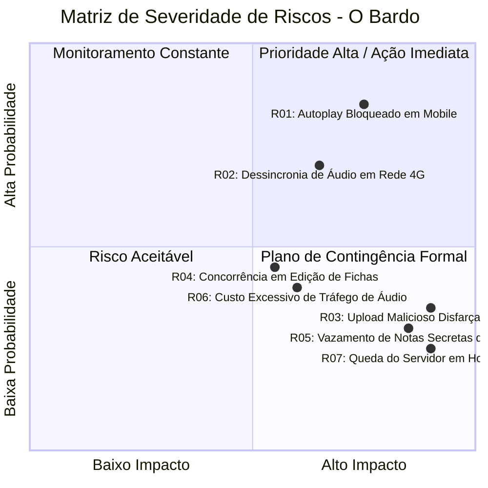

# O BARDO - PLATAFORMA WEB IMERSIVA PARA RPG DE MESA TRADICIONAL
## Plano de Gestão de Riscos (Metodologia PMI PMBOK / ISO 31000)

---

### Identificação do Documento
- **Projeto:** O Bardo (obardo.com.br)
- **Identificador:** RSK-OBAR-2026-V1
- **Versão:** 1.0.0
- **Data:** 30 de Outubro de 2026
- **Status:** Homologado
- **Repositório Oficial:** [https://github.com/fortunatolf-tech/obardo](https://github.com/fortunatolf-tech/obardo)

---

## 1. Estrutura e Metodologia de Gestão de Riscos

A gestão de riscos do projeto **O Bardo** segue as diretrizes da norma internacional **ISO 31000** e do guia **PMI PMBOK 7ª Edição**, compreendendo cinco etapas contínuas:
1. **Identificação dos Riscos:** Levantamento exaustivo de vulnerabilidades técnicas, operacionais, regulatórias e de mercado;
2. **Análise Qualitativa e Quantitativa:** Avaliação da probabilidade de ocorrência ($P$) e do impacto no projeto ($I$), graduados em escala de 1 a 5;
3. **Cálculo da Severidade ($S$):** $S = P \times I$, categorizado em:
   - *Baixo (1 a 6):* Monitoramento periódico;
   - *Médio (8 a 12):* Medidas de mitigação obrigatórias;
   - *Alto (15 a 20):* Ações preventivas prioritárias e plano de contingência formal;
   - *Crítico (25):* Risco inaceitável com intervenção imediata da arquitetura e liderança executiva;
4. **Planejamento de Respostas:** Estratégias de Mitigação (redução de probabilidade), Evitação, Transferência e Planos de Contingência (ação imediata caso o risco se materialize);
5. **Monitoramento e Controle:** Revisão contínua em cada ciclo de sprint.

---

## 2. Matriz de Probabilidade vs Impacto (5x5)

---

## 3. Matriz Analítica e Registro Detalhado de Riscos

| ID | Descrição do Risco | Categoria | P | I | Severidade ($P \times I$) | Estratégia Preventiva (Mitigação) | Plano de Contingência (Resposta) |
| :--- | :--- | :--- | :--- | :--- | :--- | :--- | :--- |
| **R01** | **Bloqueio de Autoplay pelos Navegadores Mobile** | Técnica | 4 | 4 | **16 (Alto)** | Exigir que o jogador clique em um botão de ação intencional ("Entrar na Taverna / Sintonizar") ao carregar a página, desbloqueando o `AudioContext` nativo. | Exibir modal interativo amigável com um clique caso o navegador suspenda o contexto de áudio em segundo plano. |
| **R02** | **Dessincronização Acústica em Redes Móveis com Jitter** | Técnica | 4 | 3 | **12 (Médio)** | Implementar algoritmo NTP-Lite no cliente, com microajustes de $\pm 2.5\%$ na velocidade de reprodução para compensar latências variáveis sem distorção. | Forçar recálculo temporal e salto de buffer caso o atraso acumulado ultrapasse 500 milissegundos. |
| **R03** | **Upload de Arquivo Malicioso Disfarçado de Áudio/Imagem** | Segurança | 2 | 5 | **10 (Médio)** | Validação de *Magic Bytes* no PHP 8.3 com `finfo`, renomeação criptográfica do arquivo, conversão estrita de áudio e armazenamento em diretório sem permissão de execução (`noexec`). | Quarentena imediata de arquivos suspeitos, bloqueio preventivo da conta do usuário e auditoria de logs. |
| **R04** | **Conflito de Concorrência na Edição de Fichas (Mestre vs Jogador)** | Operacional | 3 | 3 | **9 (Médio)** | Utilizar bloqueio otimista com versionamento de registro (`version_id`) ou travas por campo no nível da API REST. | A API rejeita a escrita desatualizada com código 409 Conflict e retorna o delta para mescla sem perda de dados. |
| **R05** | **Vazamento de Anotações e Segredos do Mestre para Jogadores** | Negócio / Segurança | 2 | 4 | **8 (Médio)** | Segregação estrita na camada de aplicação: endpoints de jogadores utilizam DTOs específicos que jamais incluem colunas de segredos. | Revogação de chaves, auditoria de payloads e publicação imediata de patch corretivo. |
| **R06** | **Custo Inesperado com Transferência de Áudio (Egress CDN)** | Financeira | 2 | 4 | **8 (Médio)** | Utilizar compressão de áudio altamente eficiente em formato OGG Opus (64kbps com qualidade cristalina de voz e música) e CDN com egress gratuito (Cloudflare R2). | Ativar limitação dinâmica de taxa de amostragem e limite mensal de upload para contas gratuitas. |
| **R07** | **Indisponibilidade do Servidor MariaDB em Horário Nobre** | Infraestrutura | 1 | 5 | **5 (Baixo)** | Pool de conexões otimizado, cache de leitura em memória e monitoramento ativo com alertas instantâneos via bot do Telegram. | Failover para réplica de leitura e restauração automatizada de snapshot em menos de 15 minutos. |
| **R08** | **Reclamação ou Não Conformidade com a LGPD (Lei nº 13.709/2018)** | Regulatória | 1 | 5 | **5 (Baixo)** | Política de privacidade transparente, minimização de dados, registro das operações (ROPA) e painel de autoexclusão de conta com esquecimento completo. | Acionamento imediato do Encarregado de Dados (DPO) e comunicação oficial à ANPD em até 3 dias úteis conforme Art. 48. |

---

## 4. Plano de Continuidade de Negócios e Recuperação de Desastres (Disaster Recovery Plan - DRP)

Para garantir a preservação irrevogável dos dados das campanhas e fichas de personagens de todos os jogadores:

### 4.1. Metas de Recuperação
- **RTO (Recovery Time Objective):** Tempo máximo para restabelecimento total da plataforma: **inferior a 45 minutos**;
- **RPO (Recovery Point Objective):** Perda máxima tolerável de dados transacionais: **inferior a 15 minutos**.

### 4.2. Estratégia de Backups Automatizados
1. **Snapshots Contínuos de Banco de Dados:**
   - Dump binário automatizado do MariaDB a cada 6 horas;
   - Logs binários de transação (*binary logs*) mantidos continuamente para recuperação pontual no tempo (*Point-in-Time Recovery - PITR*);
2. **Armazenamento Georredundante:**
   - Cópia criptografada (AES-256) dos dumps enviada para um segundo provedor de nuvem fisicamente isolado;
3. **Testes de Restauração Trimestrais:**
   - Simulação periódica de desastre total em ambiente de staging para validação da integridade dos backups e medição do tempo real de restauração.

---

*Plano de Gestão de Riscos formalizado e incorporado à governança oficial do projeto O Bardo.*
