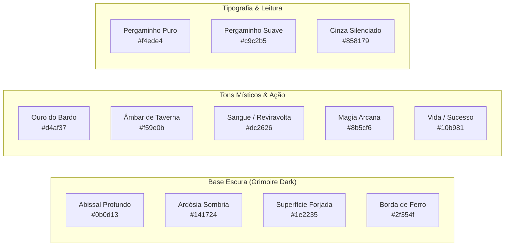

# O BARDO - PLATAFORMA WEB IMERSIVA PARA RPG DE MESA TRADICIONAL
## Guia de Estilo de Interface e Experiência do Usuário (UI/UX Style Guide)

---

### Identificação do Documento
- **Projeto:** O Bardo (obardo.com.br)
- **Sistema de Design:** *Pergaminho & Ferro (Parchment & Iron)*
- **Versão:** 1.0.0
- **Data:** 30 de Outubro de 2026
- **Status:** Homologado
- **Repositório:** [https://github.com/fortunatolf-tech/obardo](https://github.com/fortunatolf-tech/obardo)

---

## 1. Filosofia de Design e Princípios da Experiência

O Design System d'**O Bardo** foi construído sob uma premissa inegociável: **a interface do usuário deve servir à imaginação, nunca competir com ela**. 

Em mesas de RPG tradicionais, o centro das atenções é a fala do Mestre, a reação dos amigos e o drama da narrativa. A aplicação web opera como um livro místico aberto sob a luz de velas — silencioso, elegante, rápido e profundamente atmosférico.

### 1.1. Os Quatro Pilares de UX do Bardo
1. **Atmosfera Sem Ruído (Zero Cognitive Clutter):** Cada botão, ícone e número existe por uma razão prática. Nenhum elemento gráfico desnecessário rouba a atenção do Mestre no calor da descrição de uma cena;
2. **Ergonomia de Taverna (Mobile-First de Mesa):** O jogador sentado à mesa com seu smartphone deve conseguir rolar um teste de resistência ou alterar seus Pontos de Vida com apenas um polegar em menos de dois segundos;
3. **Feedback Sensorial Imediato:** Ações críticas geram resposta visual e acústica instantânea: o som de metal desembainhado ao rolar iniciativa, a vibração suave na tela no sucesso crítico e o pulso sombrio na tela quando o Mestre aciona uma reviravolta;
4. **Acessibilidade Inclusiva (WCAG 2.1 AA):** Alto contraste, legibilidade cristalina em ambientes escuros e suporte abrangente a atalhos de teclado para mestres ágeis.

---

## 2. Paleta Cromática e Tokens Semânticos

O sistema adota uma paleta baseada em tons profundos de ardósia, couro envelhecido, pergaminho e toques de latão e ouro antigo, garantindo conforto visual prolongado durante sessões noturnas de 4 a 6 horas.

### 2.1. Tabela de Cores e Tokens CSS

| Token CSS | Código HEX | Finalidade de Uso | Contraste WCAG |
| :--- | :--- | :--- | :--- |
| `--bg-abyssal` | `#0b0d13` | Fundo principal da aplicação | Base (1.0) |
| `--surface-slate` | `#141724` | Fundo de cartões, fichas e painéis | 1.2:1 |
| `--surface-elevated` | `#1e2235` | Modais, menus flutuantes e tooltips | 1.5:1 |
| `--border-iron` | `#2f354f` | Linhas divisórias e contornos de campos | 2.4:1 |
| `--gold-bardo` | `#d4af37` | Destaques nobres, títulos rúnicos, botões primários | 8.6:1 (AAA) |
| `--amber-tavern` | `#f59e0b` | Estados de aviso, iluminação de fogueira, tocha | 9.2:1 (AAA) |
| `--crimson-blood` | `#dc2626` | Dano crítico, PVs baixos, **Plot Twists** de perigo | 4.8:1 (AA) |
| `--arcane-purple` | `#8b5cf6` | Magias, grimório de feitiços, efeitos sobrenaturais | 5.1:1 (AA) |
| `--emerald-heal` | `#10b981` | Cura, sucessos em testes, áudio sincronizado ativo | 7.4:1 (AAA) |
| `--text-parchment` | `#f4ede4` | Textos principais, valores de atributos, diálogos | 14.8:1 (AAA) |
| `--text-muted` | `#9ca3af` | Rótulos secundários, descrições breves, timestamps | 6.5:1 (AA) |

---

## 3. Tipografia

O emparelhamento tipográfico combina a solenidade épica de fontes serifadas clássicas para títulos de capítulos com a legibilidade cirúrgica de fontes sans-serif humanistas para atributos numéricos e blocos de texto.

### 3.1. Famílias Tipográficas
- **Display / Títulos Épicos:** `'Cinzel', 'Cinzel Decorative', serif` (caráter heróico, entalhe de pedra clássico);
- **Interface e Leitura Contínua:** `'Inter', -apple-system, BlinkMacSystemFont, 'Segoe UI', sans-serif` (clareza ótica superior em todas as escalas);
- **Notação de Dados e Números:** `'JetBrains Mono', 'Fira Code', monospace` (alinhamento tabular perfeito de dados matemáticos).

### 3.2. Escala Tipográfica (Type Scale)

| Nível | Tamanho | Altura da Linha (Line-Height) | Peso (Weight) | Uso Principal |
| :--- | :--- | :--- | :--- | :--- |
| **Display 1** | 36px (2.25rem) | 1.2 | 700 (Bold) | Título da Campanha, Telas de Abertura |
| **Heading 1** | 28px (1.75rem) | 1.3 | 700 (Bold) | Nome do Personagem, Banner de Reviravolta |
| **Heading 2** | 20px (1.25rem) | 1.4 | 600 (Semi-Bold) | Seções da Ficha (Atributos, Grimório, Mochila) |
| **Heading 3** | 16px (1.00rem) | 1.4 | 600 (Semi-Bold) | Títulos de Faixas de Áudio e Handouts |
| **Body Large** | 16px (1.00rem) | 1.6 | 400 (Regular) | Crônicas, Diário da Guilda, Descrição de Cenas |
| **Body Medium** | 14px (0.875rem)| 1.5 | 400 (Regular) | Textos padrão de interface e cards |
| **Caption / Small**| 12px (0.75rem) | 1.4 | 500 (Medium) | Modificadores, timestamps de rolagens |

---

## 4. Anatomia e Especificações de Componentes Chave

### 4.1. Botão do Soundboard (Mestre)
- **Dimensões:** Grade responsiva de botões de $72\text{px} \times 72\text{px}$ (mobile) ou $88\text{px} \times 88\text{px}$ (desktop);
- **Estados:**
  - *Inativo:* Fundo `--surface-slate`, borda `--border-iron`, ícone opaco a 70%;
  - *Hover:* Borda ilumina em `--gold-bardo` com brilho sutil (*box-shadow: 0 0 12px rgba(212,175,55,0.2)*);
  - *Ativo / Tocando:* Fundo com pulso contínuo em `--amber-tavern` e animação de barras de equalizador acústico animado em SVG;
  - *Pressionado:* Escala de clique $0.96$.

### 4.2. Card de Pontos de Vida (PV) e Estado Vital
- Indicador numérico gigante (ex: `28 / 28`);
- Barra de preenchimento dinâmica com gradiente:
  - $\ge 50\%$: Verde Esmeralda (`--emerald-heal`);
  - $20\% \text{ a } 49\%$: Âmbar de Alerta (`--amber-tavern`);
  - $< 20\%$: Vermelho Sangue Pulsante (`--crimson-blood`);
  - $0$ PV: Estado "Inconsciente / Sangrando" com ícone de crânio estilizado.

### 4.3. Banner de Reviravolta da Trama (Live Plot Twist)
- Modal com sobreposição em tela cheia com vinheta escura semi-translúcida (`rgba(11, 13, 19, 0.88)`);
- Efeito de pulso de luz no perímetro da tela em sintonia com a classificação da reviravolta (ex: Vermelho para Traição, Dourado para Revelação Divina, Roxo para Revelação Arcana);
- Tipografia central em estilo entalhado (`Cinzel`) com animação suave de desvanecimento e escala de entrada.

---

## 5. Diretrizes de Acessibilidade e Atalhos de Teclado

### 5.1. Acessibilidade
- Todos os campos de formulário e botões interativos contêm atributos `aria-label` e estados `aria-pressed` / `aria-expanded` corretos;
- Indicadores visuais de foco com anel duplo dourado de $2\text{px}$ (`outline: 2px solid #d4af37; outline-offset: 2px;`);
- Modo de Alto Contraste selecionável nas preferências do usuário.

### 5.2. Atalhos de Produtividade para o Mestre
| Tecla de Atalho | Ação Executada |
| :--- | :--- |
| `Espaço` | Alternar Reprodução / Pausa da Trilha Musical Ativa |
| `M` | Silenciar / Dessilenciar Áudio Global (*Mute*) |
| `T` | Abrir Modal Rápido de Disparo de Reviravolta (*Plot Twist*) |
| `D` | Abrir Bandeja Flutuante de Rolagem de Dados |
| `1` a `9` | Disparar Efeitos do Soundboard nos slots 1 a 9 |
| `Esc` | Fechar qualquer modal ou visão expandida de handout |

---

*Guia de Estilo homologado para a implementação visual de todos os módulos d'O Bardo.*
