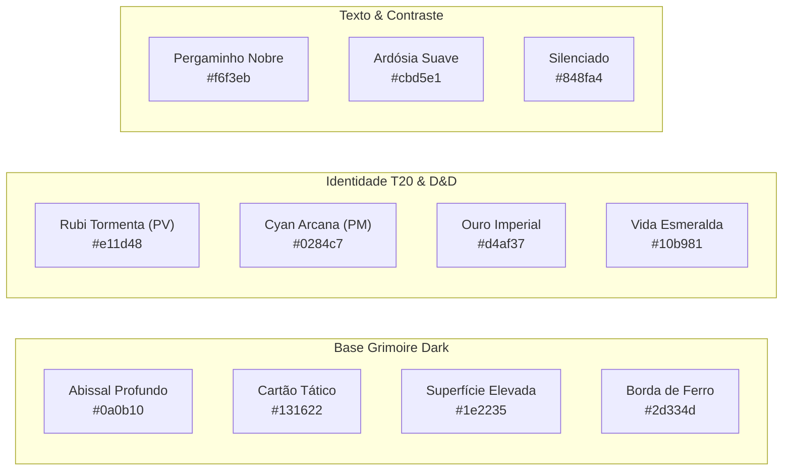

# O BARDO - PLATAFORMA WEB IMERSIVA PARA RPG DE MESA TRADICIONAL
## Guia de Estilo de Interface e Experiência do Usuário (UI/UX Style Guide)
### Design System: Tormenta20 & D&D Mobile-First (Em Conformidade com OGL / SRD)

---

### Identificação do Documento
- **Projeto:** O Bardo (obardo.com.br)
- **Sistema de Design:** *Rubi Arcano, Ouro Imperial & Aço Forjado (T20 & D&D D20 System)*
- **Versão:** 2.0.0 (Revisão Aprovada Mobile-First)
- **Data:** 30 de Outubro de 2026
- **Conformidade de Propriedade Intelectual:** Open Game License (OGL 1.0a) / Creative Commons SRD 5.1 / Compatibilidade Aberta Tormenta20 (Jambô Editora)
- **Repositório Oficial:** [https://github.com/fortunatolf-tech/obardo](https://github.com/fortunatolf-tech/obardo)

---

## 1. Filosofia de Design e Princípios Mobile-First

O design d'**O Bardo** foi reformulado com foco absoluto na experiência **Mobile-First**, inspirado na consagrada estética épica e funcional de **Tormenta20** e **Dungeons & Dragons (D&D 5e / D20 System)**, respeitando estritamente os direitos autorais e licenças de jogo aberto.

### 1.1. Os Pilares da Experiência Mobile de Mesa
1. **Operação Completa com Uma Mão (Thumb-Zone Ergonomics):** Todas as ações críticas — alterar Pontos de Vida (PV), gastar Pontos de Mana (PM), disparar dados D20 ou ativar um efeito sonoro — estão ao alcance do polegar na metade inferior da tela do smartphone através de uma barra de navegação fixa (*Bottom Dock*) e botão flutuante (*FAB*);
2. **Identidade Tormenta20 & D&D:**
   - **Medidor Duplo:** Barra Carmesim/Rubi para **PV (Pontos de Vida)** e Barra Azul Cristalino para **PM (Pontos de Mana)** com steppers rápidos de ajuste;
   - **Escudo Heróico de Defesa:** Emblema em forma de escudo destacando a Defesa/CA e o modificador de Iniciativa;
   - **Atributos D20 com Modificador Gigante:** O valor primordial na mesa é o modificador (ex: `+3`, `+1`), com o valor base (`17`, `12`) logo abaixo;
   - **Perícias Treinadas [T]:** Indicador visual de treinamento somando metade do nível + bônus de treino e atributo;
   - **Ações e Poderes com Custo em PM:** Botões táteis que debitam a mana e realizam a rolagem simultaneamente;
3. **Conformidade Irrevogável com Direitos Autorais:** Utilização das mecânicas universais abertas pelo Sistema D20 / OGL / SRD, abstendo-se de reproduzir textos proprietários ou marcas registradas de terceiros;
4. **Acústica Tátil e Feedback Visual:** Disparos de SFX (espadas, magia arcana, trovão lefeu, dados) sintetizados com a Web Audio API nativa com iluminação de borda pulsante.

---

## 2. Paleta Cromática e Tokens Semânticos

### 2.1. Tabela de Tokens CSS

| Token CSS | Código HEX | Significado / Uso em Jogo | Contraste WCAG |
| :--- | :--- | :--- | :--- |
| `--bg-abyss` | `#0a0b10` | Fundo abissal do aplicativo | Base (1.0) |
| `--bg-card` | `#131622` | Cartões e fichas de personagens | 1.2:1 |
| `--t20-ruby` | `#e11d48` | **PV (Pontos de Vida)**, Danos e Plot Twists de perigo | 5.2:1 (AA) |
| `--mana-cyan` | `#0284c7` | **PM (Pontos de Mana)**, Magias e Poderes de Classe | 6.1:1 (AAA) |
| `--gold-imperial` | `#d4af37` | Títulos heróicos, bordas nobres, botão de rolagem D20 | 8.8:1 (AAA) |
| `--emerald-life` | `#10b981` | Cura, sucessos em testes, áudio sincronizado ativo | 7.6:1 (AAA) |
| `--text-parchment`| `#f6f3eb` | Textos principais e valores numéricos | 15.2:1 (AAA) |

---

## 3. Tipografia e Escala Mobile

- **Títulos & Nomes Heróicos:** `'Cinzel', serif` (gravação em pedra rúnica, peso 700 e 800);
- **Interface, Rótulos e Textos:** `'Inter', sans-serif` (legibilidade ótica superior em telas pequenas de 360px a 430px);
- **Valores Numéricos e Dados:** `'JetBrains Mono', monospace` (alinhamento tabular perfeito de somas de dados).

---

## 4. Componentes Chave da Interface Mobile

### 4.1. Medidores de PV e PM com Steppers Rápidos
- Ao tocar na barra de **PV**, abre-se o modal inferior (*Bottom Sheet*) com botões de `-1`, `-5`, `-10` de Dano e `+1`, `+5`, `+10` de Cura com atualização em tempo real;
- Ao tocar na barra de **PM**, efetua o gasto de 1 PM para manter ou ativar feitiços com som de cristal arcano;
- Quando PV chega a 0, emite alerta de inconsciência / testes contra a morte.

### 4.2. Escudo de Defesa / CA
- Emblema central dourado com o valor de Defesa em destaque (`19`), acompanhado de atalho de rolagem para o teste de Iniciativa.

### 4.3. Grade de Atributos com Modificador Gigante
- Destaque para o Modificador (+3, +1, +2, etc.) que é o número mais utilizado na mesa de jogo;
- Ao tocar em qualquer atributo, aciona o interpretador matemático e lança a rolagem com som de dados no feed da sessão.

### 4.4. Botão Flutuante (FAB) & Gaveta D20
- Botão circular dourado fixo no canto inferior direito;
- Ao tocar, desliza suavemente a bandeja rápida com dados d4, d6, d8, d10, d12, d20, d20+bônus e d100 com detecção automática de **20 Natural (Crítico!)** e **1 Natural (Desastre!)**.

### 4.5. Barra Inferior Fixa (*Bottom Dock*)
- Acesso instantâneo com o polegar:
  - `[⚔️ Combate]` (Ataques, armas, golpes)
  - `[🔮 Magias]` (Grimório com custos em PM)
  - `[📜 Perícias]` (Lista completa com bônus treinados [T])
  - `[🎒 Mochila]` (Inventário com slots de carga)
  - `[🍻 Taverna]` (Mesa compartilhada ao vivo)

---

*Guia de Estilo Mobile-First aprovado e sincronizado com os protótipos interativos.*
