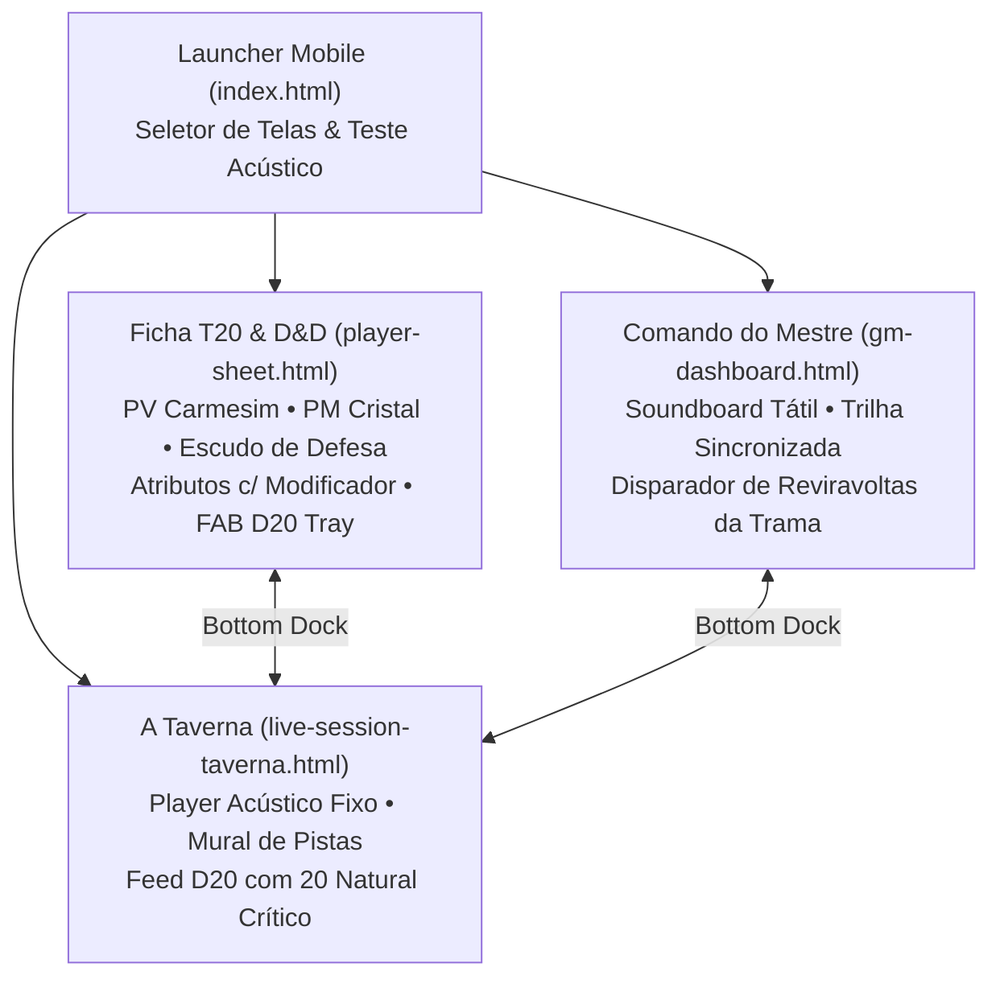

# O BARDO - PLATAFORMA WEB IMERSIVA PARA RPG DE MESA TRADICIONAL
## Especificação dos Protótipos de Alta Fidelidade (Tormenta20 & D&D Mobile-First)

---

### Identificação do Documento
- **Projeto:** O Bardo (obardo.com.br)
- **Identificador:** PROTO-OBAR-2026-V2
- **Versão:** 2.0.0 (Revisão Mobile-First T20 & D&D)
- **Data:** 30 de Outubro de 2026
- **Status:** Homologado
- **Diretório dos Protótipos Interativos:** `/docs/prototypes/`
- **Repositório:** [https://github.com/fortunatolf-tech/obardo](https://github.com/fortunatolf-tech/obardo)

---

## 1. Visão Geral da Arquitetura de Interface Mobile-First

Os protótipos de alta fidelidade d'**O Bardo** foram completamente redesenhados adotando as melhores convenções ergonômicas de **Tormenta20** e **Dungeons & Dragons (D&D 5e)**, com arquitetura estritamente **Mobile-First** para smartphones e tablets, mantendo expansibilidade fluida para telas de computadores.

---

## 2. Telas Interativas Implementadas

### 2.1. Tela 1: Ficha do Jogador (`player-sheet.html`)
- **Estilo Visual:** Inspirado na elegância das fichas de Tormenta20 e D&D Beyond;
- **Hero Header:**
  - Avatar em moldura forjada a ouro com insígnia de nível (`NV 4`);
  - Nome do herói (*Sir Galadhon*), classe e raça (*Guerreiro Arcano • Humano de Deheon*), devoção e origem;
- **Medidores Vitais Primários:**
  - **PV (Pontos de Vida):** Barra carmesim rubi com contador dinâmico e modal deslizante inferior (*Bottom Sheet*) para aplicação rápida de dano ou cura;
  - **PM (Pontos de Mana):** Barra azul cristalina dedicada para magias e poderes especiais de Tormenta20;
  - **Defesa:** Escudo metálico dourado com valor central (`19`) e atalho de rolagem de iniciativa;
- **Grade de Atributos com Modificadores:**
  - FOR (+3), DES (+1), CON (+2), INT (+2), SAB (+0), CAR (-1) com acionamento de rolagem por toque;
- **Abas de Conteúdo Mobile:**
  - `[⚔️ Combate]`: Armas com cálculo de bônus, dano versátil e golpe marcial com custo em PM;
  - `[🔮 Magias]`: Magias com círculos, custos em PM e botão de conjuração imediata;
  - `[📜 Perícias]`: Perícias OGL completas com indicador de treino `[T]` e bônus total somado;
  - `[🎒 Mochila]`: Inventário com slots de carga e capacidade de transporte;
- **Bandeja Flutuante de Dados (FAB):** Botão fixo no canto inferior que puxa a gaveta com dados d4 a d100.

---

### 2.2. Tela 2: Painel do Mestre (`gm-dashboard.html`)
- **Central de Áudio Tátil:**
  - Botões táteis de acionamento imediato de trilhas de fundo (Taverna, Masmorra e Combate com transição suave);
  - Soundboard em grade tátil para disparo de SFX sem latência (aço, trovão, rugido de monstro, magia e dados);
- **Disparador de Reviravoltas da Trama (Live Plot Twist):**
  - Painel com presets rápidos (*"A Máscara do Cônsul Cai!"*, *"Os Portais se Abrem!"*) e campo customizado;
  - Botão de impacto que cobre a tela de todos os participantes com vinheta escura, pulso carmesim e efeito sonoro de clímax;
- **Monitor do Grupo em Tempo Real:**
  - Visão simultânea das barras de PV e PM de todos os jogadores, com botões para aplicar dano ou cura com um toque;
- **Segredos do Mestre:**
  - Anotações protegidas e botão para transformar notas secretas em pistas reveladas na Taverna dos jogadores.

---

### 2.3. Tela 3: A Taverna / Sessão ao Vivo (`live-session-taverna.html`)
- **Player de Áudio Atmosférico Sincronizado:**
  - Card fixo no topo com a trilha transmitida pelo Mestre, botão de sintonização rápida e slider de volume pessoal;
- **Cards de Status dos Companheiros:**
  - Chips resumidos exibindo o estado vital (PV e PM) de cada herói na mesa física ou remota;
- **Mural de Pistas Reveladas:**
  - Cartas e mapas revelados pelo narrador com toque para expansão e leitura;
- **Feed de Rolagens com Destaque Crítico:**
  - Destaque visual dourado ou esmeralda para sucessos críticos (**20 Natural**) e alertas em vermelho para desastres.

---

*Especificação e arquivos de protótipos de alta fidelidade integrados e homologados.*
