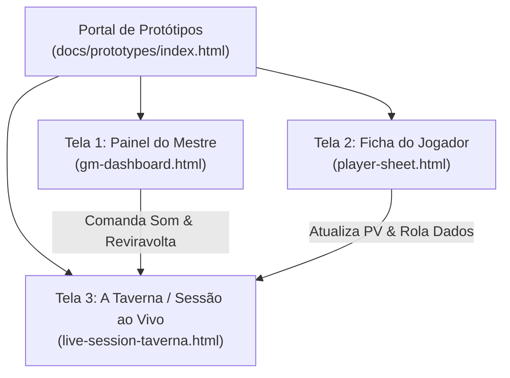

# O BARDO - PLATAFORMA WEB IMERSIVA PARA RPG DE MESA TRADICIONAL
## Especificação dos Protótipos de Alta Fidelidade

---

### Identificação do Documento
- **Projeto:** O Bardo (obardo.com.br)
- **Identificador:** PROTO-OBAR-2026-V1
- **Versão:** 1.0.0
- **Data:** 30 de Outubro de 2026
- **Status:** Homologado
- **Diretório dos Protótipos Interativos:** `/docs/prototypes/`
- **Repositório:** [https://github.com/fortunatolf-tech/obardo](https://github.com/fortunatolf-tech/obardo)

---

## 1. Visão Geral e Arquitetura de Informação

Os protótipos de alta fidelidade d'**O Bardo** foram desenvolvidos como artefatos funcionais e interativos em **HTML5, CSS3 moderno e JavaScript puro (ES6+)**, sem frameworks externos pesados. Isso permite que qualquer membro da equipe, patrocinador ou usuário teste os fluxos diretamente em seu navegador, localmente ou online no servidor.

---

## 2. Telas Interativas Implementadas

### 2.1. Tela 1: Painel de Controle do Mestre (`gm-dashboard.html`)
- **Objetivo:** Fornecer ao Mestre controle total sobre a narrativa da sessão, a mesa de som e os acontecimentos dramáticos sem fricção.
- **Componentes Chave:**
  1. **Central de Áudio & Soundboard:**
     - Seletor de Trilha de Fundo (Ambiente Taverna, Masmorra Sinistra, Combate Feroz, Viagem Noturna);
     - Grade de botões instantâneos de SFX (Trovão, Espadas, Grito, Rugido de Dragão, Porta Rangendo);
     - Faders de controle de volume por camada (Música, Ambiência, Efeitos);
     - Indicador de sincronismo em tempo real com os jogadores conectados.
  2. **Disparador de Reviravoltas da Trama (Live Plot Twist):**
     - Painel para escolher tipo de reviravolta (Traição, Revelação Sombria, Morte Iminente, Salvação Milagrosa);
     - Campo de texto para manchete e descrição rápida;
     - Botão de ativação em destaque ("DESENCADEAR REVIRAVOLTA AO VIVO") que aciona a animação de impacto na tela de todos os participantes.
  3. **Monitor de Membros e Fichas da Mesa:**
     - Lista resumida dos personagens com barras de Pontos de Vida (PV), Classe de Armadura (CA) e condições em tempo real;
     - Botões rápidos de aplicar dano ou cura.
  4. **Bloco de Segredos e Pistas Ocultas:**
     - Anotações visíveis unicamente para o Mestre;
     - Botão "Revelar aos Jogadores" para transformar notas ou pistas em handouts públicos.

---

### 2.2. Tela 2: Ficha Interativa do Jogador (`player-sheet.html`)
- **Objetivo:** Uma ficha de personagem completa, ágil e responsiva, desenhada para consulta e manipulação rápida no smartphone ou desktop.
- **Componentes Chave:**
  1. **Cabeçalho Heroico:** Nome do personagem, classe, nível, raça, ancestralidade e avatar ilustrado;
  2. **Monitor Vital:**
     - Pontos de Vida (Atuais / Máximos / Temporários) com botões `+` e `-` para ajustes imediatos durante o combate;
     - Classe de Armadura (CA), Deslocamento e Iniciativa em destaque visual;
  3. **Colunas de Atributos Clássicos:**
     - Força, Destreza, Constituição, Inteligência, Sabedoria e Carisma com cálculo instantâneo de modificadores;
     - Botão de rolagem direta associado a cada atributo;
  4. **Abas Modulares:**
     - **Aba 1 (Perícias & Combate):** Armas equipadas, bônus de ataque e dano com atalho de rolagem;
     - **Aba 2 (Inventário & Carga):** Lista de itens na mochila com contagem de slots de peso e alerta visual de sobrecarga;
     - **Aba 3 (Grimório Arcano):** Magias conhecidas, círculos mágicos e marcadores de slots de magia gastos;
     - **Aba 4 (Biografia & Notas Pessoais):** Traços de personalidade, vínculos e diário individual;
  5. **Bandeja Flutuante de Rolagem de Dados:**
     - Seletor rápido de d4, d6, d8, d10, d12, d20 e d100 com histórico auditável de resultados.

---

### 2.3. Tela 3: A Taverna / Sessão Compartilhada ao Vivo (`live-session-taverna.html`)
- **Objetivo:** O ponto de convergência de toda a campanha durante a sessão de jogo.
- **Componentes Chave:**
  1. **Player de Áudio Atmosférico Compartilhado:**
     - Exibição da trilha e ambiência ativas transmitidas pelo Mestre;
     - Botão de sintonização ("Entrar no Clima da Taverna") para desbloquear o `AudioContext` do navegador respeitando políticas de autoplay;
     - Controle deslizante de volume local para o jogador;
  2. **Mural de Handouts e Pistas Reveladas:**
     - Cartas antigas, pergaminhos decifrados e fragmentos de mapas revelados pelo Mestre;
     - Zoom modal para leitura de cartas com tipografia medieval legível;
  3. **Crônica da Sessão em Tempo Real:**
     - Registro narrativo colaborativo dos acontecimentos do dia;
  4. **Feed de Rolagens e Chat da Mesa:**
     - Log contínuo e ordenado de todas as rolagens de dados efetuadas pelos jogadores com detalhes matemáticos;
  5. **Camada de Reviravolta da Trama (Plot Twist Overlay):**
     - Mecanismo integrado que escuta os comandos do Mestre e estampa o anúncio dramático na tela cheia com vinheta escura pulsante e som orquestrado.

---

## 3. Guia de Execução dos Protótipos

Os arquivos estão localizados no diretório `/docs/prototypes/` do repositório:
- Abra `docs/prototypes/index.html` em qualquer navegador web moderno para navegar entre os três protótipos interativos;
- Teste a execução do áudio através do simulador integrado com a **Web Audio API**;
- Teste a rolagem de dados com o gerador matemático criptograficamente seguro;
- Teste o acionamento de reviravoltas da trama com as animações do Design System *Pergaminho & Ferro*.

---

*Especificação e arquivos de protótipos de alta fidelidade integrados ao repositório oficial.*
