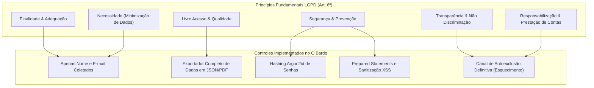
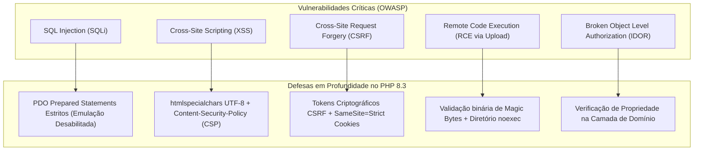
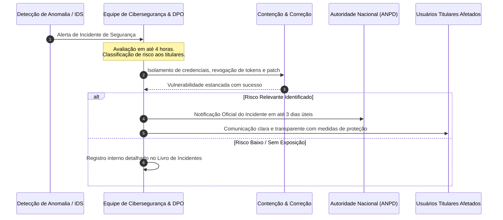

# O BARDO - PLATAFORMA WEB IMERSIVA PARA RPG DE MESA TRADICIONAL
## Requisitos de Cibersegurança e Conformidade com a LGPD (Lei nº 13.709/2018)

---

### Identificação do Documento
- **Projeto:** O Bardo (obardo.com.br)
- **Identificador:** SEC-LGPD-OBAR-2026-V1
- **Versão:** 1.0.0
- **Data:** 30 de Outubro de 2026
- **Status:** Homologado
- **Marco Regulatório:** Lei Geral de Proteção de Dados Pessoais (Lei nº 13.709/2018), Marco Civil da Internet (Lei nº 12.965/2014) e OWASP Application Security Verification Standard (ASVS v4.0.3)
- **Repositório:** [https://github.com/fortunatolf-tech/obardo](https://github.com/fortunatolf-tech/obardo)

---

## 1. Princípios de Privacidade e Proteção de Dados (Privacy by Design)

A arquitetura do sistema **O Bardo** adota os princípios fundamentais de *Privacy by Design* e *Privacy by Default*, garantindo que a proteção dos dados dos jogadores e mestres esteja embutida no núcleo da aplicação web em PHP 8.3 desde o primeiro dia de concepção.



---

## 2. Registro das Operações de Tratamento de Dados (ROPA - Art. 37 da LGPD)

| Categoria do Dado | Dados Específicos Coletados | Finalidade do Tratamento | Base Legal (Art. 7º LGPD) | Prazo de Retenção |
| :--- | :--- | :--- | :--- | :--- |
| **Identificação Cadastral** | Nome completo ou apelido, endereço de e-mail, hash de senha criptográfica. | Autenticação, controle de acesso à conta e recuperação de credenciais. | Inciso V (Execução de contrato / termos de uso). | Até o encerramento voluntário da conta pelo titular. |
| **Registros de Conexão e Auditoria** | Endereço IP de origem, porta lógica reversa, carimbos de data/hora (UTC) de login e ações críticas. | Cumprimento de obrigação legal imposta pelo Marco Civil da Internet (Lei nº 12.965/2014, Art. 15). | Inciso II (Cumprimento de obrigação legal ou regulatória). | Exatamente 6 meses após o registro da conexão. |
| **Dados Lúdicos e de Campanha** | Fichas de personagens, histórico de rolagens de dados, crônicas da guilda, faixas de áudio carregadas. | Prestação do serviço essencial de RPG de mesa e sincronização com o Mestre. | Inciso V (Execução de contrato / prestação do serviço). | Enquanto a campanha permanecer ativa ou até solicitação de exclusão. |
| **Preferências e Sessão Local** | Volume de som selecionado, tema de interface (claro/escuro), estado de rolador. | Personalização de uso e ergonomia visual no dispositivo. | Inciso IX (Legítimo interesse do controlador). | Armazenamento local no navegador (`localStorage`), sem trânsito para o servidor. |

> [!NOTE]
> O Bardo **NÃO** coleta, armazena ou processa Dados Pessoais Sensíveis (origem racial ou étnica, convicção religiosa, opinião política, filiação sindical ou a organização de caráter religioso, dados de saúde ou orientação sexual) previstos no Art. 5º, II da LGPD.

---

## 3. Matriz de Direitos dos Titulares de Dados (Art. 18 da LGPD)

A plataforma disponibiliza ferramentas automatizadas de autoatendimento para que o titular exerça seus direitos diretamente nas configurações de sua conta:

1. **Confirmação e Acesso aos Dados (Art. 18, I e II):** O usuário pode visualizar a qualquer momento todas as informações cadastrais e campanhas vinculadas ao seu perfil via painel web ou pelo endpoint `GET /api/v1/auth/me`;
2. **Correção de Dados Incompletos ou Inexatos (Art. 18, III):** O usuário pode retificar seu nome de exibição, e-mail e redefinir sua senha diretamente na interface;
3. **Portabilidade dos Dados (Art. 18, V):** Funcionalidade de um clique ("Exportar Meus Dados") que gera um arquivo `.zip` contendo todas as fichas de personagens em formato padronizado JSON estruturado e resumos de crônicas em Markdown;
4. **Eliminação dos Dados Pessoais / Direito ao Esquecimento (Art. 18, VI):**
   - Ao acionar a opção "Excluir Definitivamente Minha Conta", o sistema executa a purga irreversível de todos os registros relacionais no MariaDB;
   - As fichas criadas são desvinculadas, os arquivos de áudio privados do usuário são expurgados do storage;
   - Os dados de auditoria estritamente exigidos pelo Art. 15 do Marco Civil da Internet são mantidos em cofre criptografado isolado pelo prazo improrrogável de 6 meses, sendo destruídos automaticamente ao término do período;
5. **Revogação do Consentimento (Art. 18, IX):** Cancelamento imediato de quaisquer comunicações opcionais ou notificações por e-mail.

---

## 4. Requisitos e Controles de Cibersegurança (Defense-in-Depth)

### 4.1. Criptografia e Armazenamento Seguro de Credenciais
- **Algoritmo de Hash Obrigatório:** **Argon2id** (em conformidade com as diretrizes do OWASP Password Storage Cheat Sheet):
  - Memória de custo: $65.536\text{ KiB}$ (64 MB);
  - Iterações de tempo: $4$;
  - Paralelismo: $2$ threads;
  - Salt criptográfico gerado via gerador de números aleatórios de nível de sistema operacional (`random_bytes(16)`).
- **Proibição Absoluta:** O uso de algoritmos legados e quebrados (MD5, SHA1, SHA256 simples sem sal, DES) é estritamente bloqueado na base de código.

### 4.2. Criptografia em Trânsito (TLS 1.3)
- Todas as conexões HTTP são redirecionadas compulsoriamente pelo Nginx para HTTPS;
- Configuração estrita de cifras modernas (ChaCha20-Poly1305, AES-128-GCM, AES-256-GCM);
- Cabeçalho HTTP Strict Transport Security (HSTS) habilitado:
  ```http
  Strict-Transport-Security: max-age=31536000; includeSubDomains; preload
  ```

### 4.3. Proteção Contra o OWASP Top 10



1. **Prevenção contra SQL Injection (SQLi):**
   - 100% das consultas ao MariaDB utilizam comandos parametrizados via PDO com emulação desativada:
     ```php
     $pdo->setAttribute(PDO::ATTR_EMULATE_PREPARES, false);
     $pdo->setAttribute(PDO::ATTR_ERRMODE, PDO::ERRMODE_EXCEPTION);
     ```
   - Nenhuma concatenação dinâmica de strings em comandos SQL é tolerada no projeto.
2. **Prevenção contra Cross-Site Scripting (XSS):**
   - Todo dado originado de usuários exibido na interface passa por codificação estrita:
     ```php
     htmlspecialchars($input, ENT_QUOTES | ENT_SUBSTITUTE | ENT_HTML5, 'UTF-8');
     ```
   - Cabeçalho restritivo de Content Security Policy (CSP):
     ```http
     Content-Security-Policy: default-src 'self'; script-src 'self'; style-src 'self' 'unsafe-inline' https://fonts.googleapis.com; font-src 'self' https://fonts.gstatic.com; media-src 'self' blob:; connect-src 'self';
     ```
3. **Prevenção contra Upload Malicioso e RCE:**
   - Validação estrita do tipo binário real do arquivo (*Magic Bytes*) usando `finfo_file()` da biblioteca `fileinfo` do PHP 8.3, ignorando solenemente a extensão declarada no formulário:
     - Áudios permitidos: `audio/mpeg` (MP3), `audio/ogg` / `audio/opus`;
     - Imagens de fichas/handouts: `image/webp`, `image/jpeg`, `image/png`.
   - Renomeação compulsória de todo arquivo carregado utilizando identificadores únicos universais criptográficos (`uuid_v4()`);
   - Os arquivos de upload são gravados em diretório fisicamente isolado sem permissão de execução de scripts pelo servidor web Nginx:
     ```nginx
     location ~ ^/storage/.*\.(php|php5|php8|phtml|phar|sh|py|pl|cgi)$ {
         deny all;
         return 404;
     }
     ```
4. **Prevenção contra Quebra de Autorização (IDOR):**
   - Antes de permitir qualquer edição em ficha, som ou campanha, o backend valida se o `user_id` autenticado detém explicitamente o papel de Mestre da campanha ou proprietário legítimo do personagem.

---

## 5. Plano de Resposta a Incidentes de Segurança e Notificação à ANPD

Em conformidade estrita com o **Artigo 48 da LGPD**, qualquer incidente de segurança que possa acarretar risco ou dano relevante aos titulares seguirá o protocolo formal:



### 5.1. Conteúdo da Notificação Oficial (Art. 48, § 1º)
Caso haja comunicação à ANPD e aos titulares, o comunicado incluirá:
1. Natureza dos dados pessoais afetados;
2. Informações sobre os titulares envolvidos;
3. Indicação das medidas técnicas e de segurança utilizadas para a proteção dos dados;
4. Riscos relacionados ao incidente;
5. Motivos da eventual demora, caso a comunicação não tenha sido imediata;
6. Medidas que foram ou que serão adotadas para reverter ou mitigar os efeitos do prejuízo.

---

*Requisitos de Cibersegurança e Conformidade LGPD formalizados e vinculados aos padrões de engenharia do projeto O Bardo.*
