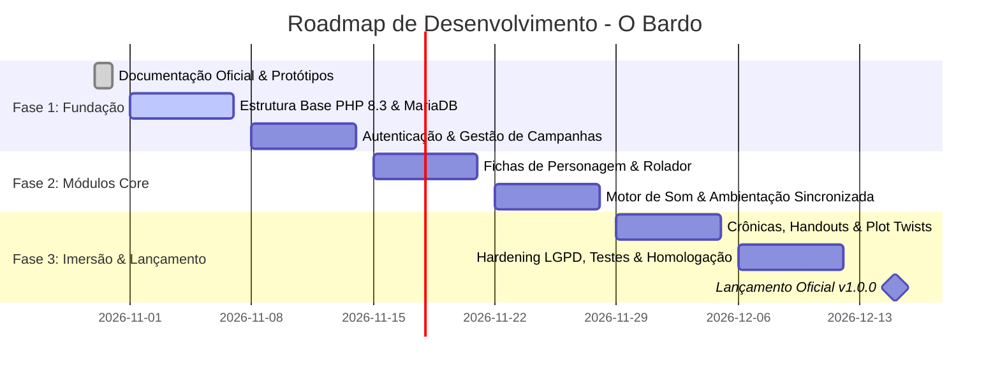

# O BARDO - PLATAFORMA WEB IMERSIVA PARA RPG DE MESA TRADICIONAL
## Registro de Futuras Issues e Roadmap de Desenvolvimento

---

### Identificação do Documento
- **Projeto:** O Bardo
- **Identificador:** ISS-OBAR-2026-V1
- **Versão:** 1.0.0
- **Data:** 30 de Outubro de 2026
- **Status:** Ativo / Planejamento
- **Repositório:** [https://github.com/fortunatolf-tech/obardo](https://github.com/fortunatolf-tech/obardo)

---

## 1. Visão Geral do Roadmap

O desenvolvimento d'**O Bardo** é dividido em sprints ágeis organizadas por Épicas prioritárias. Todo o fluxo de trabalho é rastreado diretamente através de issues e milestones no repositório oficial do GitHub.

---

## 2. Catálogo das Épicas e Registro de Issues Oficiais

### [EPIC-01] Arquitetura Core e Base PHP 8.3
- **Descrição:** Estruturação do arcabouço técnico limpo em PHP 8.3 nativo, container de injeção de dependências, roteador RESTful com middlewares e conexão segura PDO com MariaDB 10.11.
- **Labels:** `backend`, `architecture`, `priority:critical`
- **Critérios de Aceitação:**
  - Carregamento automático via Composer seguindo PSR-4 (`OBardo\`);
  - Roteador HTTP mapeando verbos REST com suporte a parâmetros dinâmicos;
  - Conexão PDO com `PDO::ATTR_EMULATE_PREPARES => false`.

### [EPIC-02] Módulo de Autenticação Segura, RBAC e Gestão de Campanhas
- **Descrição:** Implementação dos endpoints de cadastro, login com hash Argon2id, emissão de tokens de sessão, criação de campanhas e ingresso por código curto/link.
- **Labels:** `backend`, `security`, `auth`
- **Critérios de Aceitação:**
  - Registro e validação de senhas com no mínimo 8 caracteres contendo maiúsculas, minúsculas e números;
  - Middleware de controle de acesso distinguindo privilégios de Mestre vs Jogador;
  - Geração de código de campanha único alfanumérico.

### [EPIC-03] Motor Dinâmico de Fichas de Personagem e Rolador de Dados
- **Descrição:** Construtor de fichas com cálculo de atributos (OSR, D&D 5e, Tormenta20), monitor de Pontos de Vida, inventário com controle de carga e rolador matemático de dados com semente criptográfica CSPRNG.
- **Labels:** `backend`, `frontend`, `feature`
- **Critérios de Aceitação:**
  - Avaliação de expressões matemáticas de dados (`1d20+5`, `4d6kh3`, etc.);
  - Sincronização automática das alterações de PV e inventário entre Jogador e Mestre;
  - Histórico auditável de rolagens com timestamps no feed da sessão.

### [EPIC-04] Motor de Som e Ambientação Acústica Sincronizada em Tempo Real
- **Descrição:** Desenvolvimento da mesa de som do Mestre (soundboard SFX e trilhas de fundo multicamada) e canal de distribuição Server-Sent Events (SSE) para reprodução sincronizada em tempo real nos dispositivos de todos os participantes.
- **Labels:** `audio-engine`, `realtime`, `frontend`, `backend`
- **Critérios de Aceitação:**
  - Disparo de Play/Pause/Seek pelo Mestre recebido em menos de 200ms pelos participantes;
  - Algoritmo de compensação de drift temporal no cliente via Web Audio API;
  - Controle de volume local individual por participante.

### [EPIC-05] Módulo de Crônicas Colaborativas, Diário da Guilda e Mural de Pistas
- **Descrição:** Painel compartilhado de crônicas da campanha, linha do tempo dos acontecimentos e mural de handouts (cartas antigas, pergaminhos decifrados e mapas) revelados pelo Mestre.
- **Labels:** `frontend`, `feature`
- **Critérios de Aceitação:**
  - Suporte a formatação rica Markdown seguro;
  - Controle de visualização de pistas (Oculto vs Revelado ao Grupo);
  - Ordenação cronológica por data de sessão.

### [EPIC-06] Mecanismo de Reviravoltas da Trama ao Vivo (Live Plot Twist)
- **Descrição:** Ferramenta exclusiva do Mestre para disparar momentos de clímax narrativo com exibição dramática em tela cheia na interface de todos os jogadores, acompanhada de efeito sonoro de impacto.
- **Labels:** `frontend`, `feature`, `ux/ui`
- **Critérios de Aceitação:**
  - Modal em tela cheia com vinheta escura pulsante no cliente ao receber o evento;
  - Disparo sincronizado de áudio de suspense/impacto;
  - Registro do acontecimento no log da sessão.

### [EPIC-07] Hardening de Cibersegurança, Mitigações OWASP e Conformidade LGPD
- **Descrição:** Aplicação rigorosa das diretrizes de segurança da informação, sanitização de uploads com validação binária de magic bytes, cabeçalhos de segurança (CSP, HSTS) e implementação do painel de direitos dos titulares (LGPD).
- **Labels:** `security`, `compliance`, `lgpd`
- **Critérios de Aceitação:**
  - Bloqueio de arquivos maliciosos de upload disfarçados;
  - Endpoint de autoexclusão de conta com destruição definitiva de dados pessoais;
  - Exportação de dados do usuário em JSON/PDF.

### [EPIC-08] Testes Automatizados e Pipeline de CI/CD
- **Descrição:** Configuração de testes unitários com PHPUnit 11, análise estática rigorosa com PHPStan Level 8 e pipeline automatizado no GitHub Actions.
- **Labels:** `testing`, `devops`, `ci-cd`
- **Critérios de Aceitação:**
  - Cobertura de testes unitários superior a 80% nas regras de domínio;
  - Zero erros acusados no PHPStan nível 8;
  - Execução automatizada e bloqueio de merge em falhas.

---

*Registro de Issues homologado para publicação e acompanhamento no repositório oficial do GitHub.*
